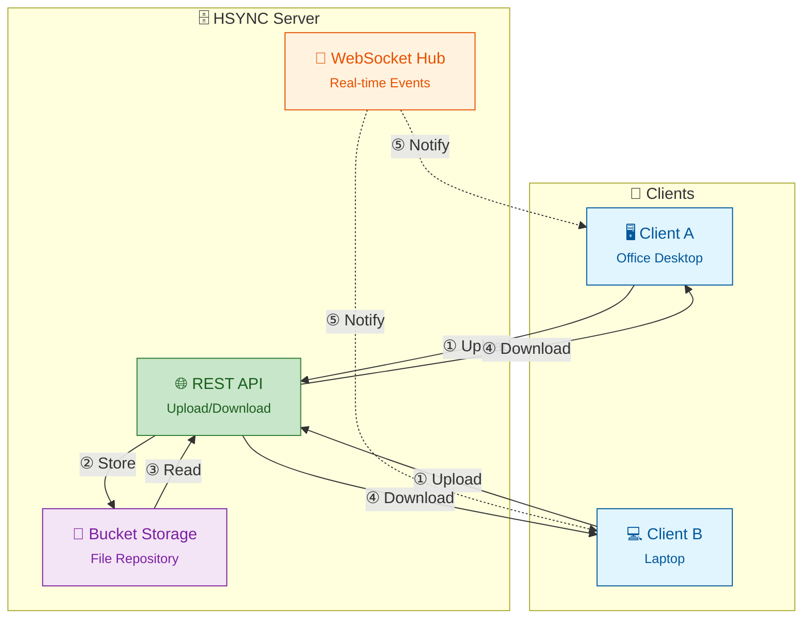

# HSYNC Server

> [!WARNING]
> **HSYNC manipulates files and directories** — it creates, overwrites, moves, and deletes data.
> Misconfiguration, software defects, or other unforeseen conditions may lead to **data loss or
> corruption**. **Use at your own risk and always keep verified, independent backups.**
> The software is provided "as is", without warranty of any kind — see the full
> [Disclaimer](#disclaimer) and [License](#license) below.

---

**HSYNC Server** - HTTP-based file synchronization server.

Central server for HSYNC clients. Manages buckets (shared directories), handles file uploads/downloads via REST API, and broadcasts real-time events to connected clients via WebSocket.

## Architecture Overview



**Flow:**
1. **① Upload** — Clients upload files to REST API
2. **② Store** — API writes files to bucket storage
3. **③ Read** — API reads files from bucket storage
4. **④ Download** — API sends files to requesting clients
5. **⑤ Notify** — WebSocket broadcasts events to connected clients

## Features

- 🚀 REST API server for file upload/download
- 📁 Bucket management for file organization
- 🔄 WebSocket for real-time synchronization
- 🔐 API Key authentication (Bearer Token)
- ✅ SHA-256-based file integrity verification
- 📊 Integrated Prometheus metrics
- 🐳 Docker-ready deployment
- 🛡️ Rate limiting to prevent API abuse
- 🔗 Symbolic link synchronization support
- 📦 Per-bucket connection management for scalability
- ⏩ Resumable uploads (offset-based, with `upload-status` checks)
- 🪦 Deletion tombstones to prevent resurrecting files deleted on another peer
- ⏱️ Clock-synchronization endpoint for NTP-like client offset correction
- 🗜️ Zstandard (zstd) transfer compression

## Requirements

- Docker

## Quick Start

```bash
cd hsync-server

# Build the Docker image
./docker.sh build

# Start the server (requires environment file)
./docker.sh start --env-file prod.env
```

## Command Line Options

```bash
hsync-server [options]
```

| Option | Description | Default |
|--------|-------------|---------|
| `--env-file PATH` | Load environment variables from file | - |
| `-p, --port PORT` | Server port | `8765` |
| `--log-level LEVEL` | Log level (debug, info, warning, error) | `info` |
| `--ssl` | Enable HTTPS/WSS (auto-generates certs if not provided) | disabled |
| `--ssl-cert FILE` | Path to SSL certificate (PEM format) | auto-generated |
| `--ssl-key FILE` | Path to SSL private key (PEM format) | auto-generated |
| `--ssl-cert-dir DIR` | Directory for auto-generated certificates | `./certs` |
| `-V, --version` | Show version | - |

### Examples

```bash
# Start server on default port (8765)
hsync-server

# Start server on custom port
hsync-server --port 9000

# Start with HTTPS enabled (auto-generates certificates)
hsync-server --ssl

# Start with custom SSL certificates
hsync-server --ssl --ssl-cert /path/to/cert.pem --ssl-key /path/to/key.pem

# Start with debug logging
hsync-server --log-level debug

# Load configuration from environment file
hsync-server --env-file /path/to/prod.env
```

## Configuration

The server uses environment variables for configuration. Create a `.env` file or use the provided `dev.env`/`prod.env` templates:

| Variable | Description | Default |
|----------|-------------|---------|
| `HSYNC_API_KEY` | API key for authentication (required) | (empty) |
| `HSYNC_PORT` | Server port | `8765` |
| `HSYNC_LOG_LEVEL` | Log level (`debug`, `info`, `warning`, `error`, `critical`) | `info` |
| `HSYNC_WORKERS` | Number of uvicorn workers | `1` |
| `HSYNC_TZ` | Timezone in IANA format (e.g., `Europe/Rome`) | `UTC` |
| `HSYNC_BUCKETS` | Directory where bucket data is stored | `<app>/buckets` |
| `HSYNC_MAX_UPLOAD_SIZE` | Maximum upload size in bytes | `10737418240` |
| `HSYNC_MIN_FREE_DISK_SPACE` | Minimum free disk space before accepting uploads (`0` disables) | `524288000` |
| `HSYNC_CORS_ENABLED` | Enable CORS middleware (`true`/`false`) | `false` |
| `HSYNC_CORS_ORIGINS` | Comma-separated allowed CORS origins | (empty) |
| `HSYNC_ENABLE_DOCS` | Expose `/docs` and `/redoc` | `false` |

> ⚠️ **Warning**: Multi-worker mode (`HSYNC_WORKERS > 1`) is NOT recommended. WebSocket connections and SHA-256 cache are not shared between workers.

### SSL/TLS Configuration

| Variable | Description | Default |
|----------|-------------|---------|
| `HSYNC_SSL_ENABLED` | Enable HTTPS/WSS (`true`/`false`) | `false` |
| `HSYNC_SSL_KEYFILE_PASSWORD` | Password used to encrypt/decrypt the SSL private key on disk (**required when SSL is enabled**) | (empty) |
| `HSYNC_SSL_CERTFILE` | Path to SSL certificate (PEM format) | (auto-generated) |
| `HSYNC_SSL_KEYFILE` | Path to SSL private key (PEM format, encrypted PKCS#8) | (auto-generated) |
| `HSYNC_SSL_CERT_DIR` | Directory for auto-generated certificates | `./certs` |

### WebSocket Configuration

| Variable | Description | Default |
|----------|-------------|---------|
| `HSYNC_WS_HEARTBEAT_INTERVAL` | Heartbeat interval in seconds | `30` |
| `HSYNC_WS_HEARTBEAT_TIMEOUT` | Heartbeat timeout in seconds | `10` |
| `HSYNC_WS_AUTH_TIMEOUT` | Seconds to wait for WebSocket auth message | `10` |
| `HSYNC_WS_MAX_CONNECTIONS` | Maximum concurrent WebSocket connections | `1000` |
| `HSYNC_WS_MAX_CONNECTIONS_PER_IP` | Maximum concurrent WebSocket connections per IP | `10` |

### Tombstone Configuration

| Variable | Description | Default |
|----------|-------------|---------|
| `HSYNC_TOMBSTONE_TTL_DAYS` | Days to retain deletion markers (`0` = forever) | `30` |

## SSL/TLS (HTTPS/WSS)

The server supports encrypted communication via HTTPS and WSS (WebSocket Secure).
SSL private keys are **always stored encrypted on disk** (PKCS#8 +
BestAvailableEncryption); `HSYNC_SSL_KEYFILE_PASSWORD` is therefore mandatory
whenever `HSYNC_SSL_ENABLED=true`. Source the password from a secret manager
(HashiCorp Vault, AWS Secrets Manager, k8s secret, systemd `LoadCredentialEncrypted=`,
…) rather than committing it to the repository.

### Quick Start with Self-Signed Certificates

```bash
# Enable SSL - certificates are auto-generated if not provided.
# HSYNC_SSL_KEYFILE_PASSWORD is required and is used to encrypt the new key.
HSYNC_SSL_ENABLED=true \
HSYNC_SSL_KEYFILE_PASSWORD="$(openssl rand -base64 32)" \
HSYNC_API_KEY=secret ./docker.sh start
```

When SSL is enabled without explicit certificate paths, the server automatically generates self-signed certificates in the `certs/` directory with:
- RSA 2048-bit key (encrypted PKCS#8 PEM)
- SHA-256 signature
- 1-year validity
- Subject Alternative Names (SAN) for hostname, localhost, 127.0.0.1, ::1

### Using Custom Certificates

For production, use certificates from a trusted CA (e.g., Let's Encrypt). The
private key file must be encrypted with `HSYNC_SSL_KEYFILE_PASSWORD`:

```bash
export HSYNC_SSL_ENABLED=true
export HSYNC_SSL_KEYFILE_PASSWORD="$(cat /run/secrets/hsync_ssl_password)"
export HSYNC_SSL_CERTFILE=/etc/letsencrypt/live/yourdomain/fullchain.pem
export HSYNC_SSL_KEYFILE=/etc/letsencrypt/live/yourdomain/privkey.pem
./docker.sh start
```

### Client Connection with Self-Signed Certificates

Clients connecting to a server with self-signed certificates need to either:

1. **Trust the certificate** (recommended):
   ```bash
   # Copy the server certificate to the client
   scp server:/path/to/certs/server.crt ./server.crt

   # Connect using the CA certificate
   hsync -s https://server:8765 -b mybucket --ca-cert server.crt
   ```

2. **Disable verification** (not recommended for production):
   ```bash
   hsync -s https://server:8765 -b mybucket --insecure
   ```

### Endpoints with SSL

| Protocol | Endpoint |
|----------|----------|
| HTTPS | `https://host:8765/api/v1/...` |
| WSS | `wss://host:8765/api/v1/buckets/{bucket}/events/{cid}` |

## Docker

The server is designed to run in Docker. Use the `docker.sh` script for all operations:

### Commands

```bash
./docker.sh build       # Build the Docker image
./docker.sh start       # Start the container
./docker.sh stop        # Stop the container
./docker.sh restart     # Restart the container
./docker.sh status      # Show container status
./docker.sh logs        # Show container logs
./docker.sh logs -f     # Follow container logs
./docker.sh shell       # Open a shell in the running container
./docker.sh clean       # Remove container and image
```

### Using Environment Files

```bash
# Development
./docker.sh start --env-file dev.env

# Production
./docker.sh start --env-file prod.env
```

`docker.sh` passes the selected file to Docker with `--env-file`; it does not
`source` the file in the shell. This keeps shell code out of the wrapper and
avoids putting secret values such as `HSYNC_API_KEY` directly in the Docker
command line.

### Environment Variables

You can also set non-secret environment variables directly. For secrets, prefer
an env file with restrictive permissions or your platform's secret manager:

```bash
export HSYNC_API_KEY
./docker.sh start
```

When `HSYNC_API_KEY` is already present in the parent environment, `docker.sh`
passes it by name (`-e HSYNC_API_KEY`) rather than embedding the value in the
process arguments.

### Debug Container

```bash
docker run --rm -it --entrypoint=/bin/sh hsync:1.0.0
```

## REST API

> 📖 For detailed API documentation, see [docs/api.md](docs/api.md)

### Buckets

| Method | Endpoint | Description |
|--------|----------|-------------|
| `GET` | `/api/v1/buckets/{bucket}` | Get bucket information |
| `POST` | `/api/v1/buckets?bucket={name}` | Create a new bucket |
| `DELETE` | `/api/v1/buckets/{bucket}` | Delete a bucket |

### Files

| Method | Endpoint | Description |
|--------|----------|-------------|
| `GET` | `/api/v1/buckets/{bucket}/files` | List files in bucket |
| `POST` | `/api/v1/buckets/{bucket}/files` | Upload file (multipart/form-data) |
| `GET` | `/api/v1/buckets/{bucket}/files/download?filename={path}` | Download file |
| `DELETE` | `/api/v1/buckets/{bucket}/files` | Delete file |
| `GET` | `/api/v1/buckets/{bucket}/files/upload-status` | Check resumable-upload status (offset) |

### Tombstones

| Method | Endpoint | Description |
|--------|----------|-------------|
| `GET` | `/api/v1/buckets/{bucket}/tombstones` | List deletion markers for a bucket |
| `POST` | `/api/v1/buckets/{bucket}/tombstones` | Merge deletion markers pushed by a peer |

### Monitoring & Sync

| Method | Endpoint | Description | Auth |
|--------|----------|-------------|------|
| `GET` | `/health` | Health check (empty `200 OK`) | No |
| `GET` | `/metrics` | Prometheus metrics | No |
| `GET` | `/api/v1/time` | Server timestamp for client clock sync | No |

### Upload Parameters

| Field | Type | Description |
|-------|------|-------------|
| `cid` | string | Client ID |
| `file` | file | File to upload |
| `path` | string | Relative path in bucket |
| `ctime` | string | Creation time |
| `mtime` | string | Modification time |
| `sha256sum` | string | SHA-256 checksum |
| `permissions` | string | File permissions (e.g., `-rw-rw-r--`) |

## WebSocket

### Endpoint

```
ws://host:8765/api/v1/buckets/{bucket}/events/{cid}
```

### Authentication

After connecting, the client must send an authentication message:

```json
{"type": "auth", "token": "your-api-key"}
```

Server responds with:
```json
{"type": "auth", "status": "ok"}
```

If authentication fails, the connection is closed with an appropriate error code.

### Supported Events

| Event | Description |
|-------|-------------|
| `added` | File/directory added |
| `modified` | File/directory modified |
| `renamed` | File/directory renamed |
| `deleted` | File/directory deleted |
| `symlink` | Symbolic link created/modified |

### Message Format

```json
{
  "name": "added|modified|renamed|deleted|symlink",
  "src": { "filepath": "...", "name": "...", ... },
  "dst": { ... }  // only for 'renamed'
}
```

## File Compression

HSYNC Server supports automatic file compression to optimize transfers using **Zstandard (zstd)**.

### How It Works

- Files are compressed before sending to clients (downloads)
- Incoming compressed uploads are decompressed before storage
- Server informs clients about compression support via WebSocket handshake
- Compression uses `Content-Encoding: zstd` header

### Compression Threshold

| Context | Threshold | Rationale |
|---------|-----------|-----------|
| **Download** (Server→Client) | 10 KB | Below this, compression overhead exceeds transfer savings |

### Skipped Files

Compression is automatically skipped for:
- Files below 10 KB
- Pre-compressed formats: `.jpg`, `.png`, `.mp4`, `.zip`, `.gz`, `.pdf`, `.docx`, etc.
- Resumable downloads (Range requests)

### Configuration

| Variable | Description | Default |
|----------|-------------|---------|
| `HSYNC_COMPRESSION_ENABLED` | Enable/disable compression | `true` |

## Rate Limiting

The server implements per-IP rate limiting (slowapi) to prevent API abuse.
All limits are configurable via environment variables:

| Endpoint | Default limit | Environment variable |
|----------|---------------|----------------------|
| Upload (`/api/v1/buckets/{bucket}/files` POST) | 200/minute | `HSYNC_RATE_LIMIT_UPLOAD` |
| Download (`/api/v1/buckets/{bucket}/files/download`) | 1000/minute | `HSYNC_RATE_LIMIT_DOWNLOAD` |
| WebSocket connections (`.../events/{cid}`) | 50/minute | `HSYNC_RATE_LIMIT_WEBSOCKET` |
| Other endpoints (list, delete, buckets, tombstones, upload-status) | 500/minute | `HSYNC_RATE_LIMIT_DEFAULT` |
| WebSocket event messages (per connection) | 10/second | `HSYNC_RATE_LIMIT_WS_MESSAGES` |

Rate limit values use the format `<number>/<period>`, where period is one of
`second`, `minute`, `hour`, or `day`.

When a rate limit is exceeded, the server returns HTTP 429 (Too Many Requests).

> **Reverse proxies**: `X-Forwarded-For` is honoured only when the direct peer
> is listed in `HSYNC_TRUSTED_PROXIES` (comma-separated). Otherwise the header is
> ignored and the direct peer address is used, preventing rate-limit bypass via
> IP spoofing.

## Health Check

```bash
curl http://localhost:8765/health
```

## Prometheus Metrics

```bash
curl http://localhost:8765/metrics
```

## Documentation

- [Architecture](docs/architecture.md) - System architecture and component overview
- [Architecture Decision Records](https://github.com/albertobasso/hsync-common/blob/main/docs/adr/README.md) - Why the stable, cross-project decisions were made
- [API Reference](docs/api.md) - Complete REST and WebSocket API documentation
- [Synchronization Flow](docs/sync-flow.md) - How file synchronization works
- [Contributing](CONTRIBUTING.md) - Development setup and contribution guidelines
- [Security Policy](SECURITY.md) - Supported versions and how to report vulnerabilities

### Related projects

- [HSYNC Common](https://github.com/albertobasso/hsync-common/blob/main/README.md) - Shared models, constants, and utilities used by the server
- [HSYNC Client](https://github.com/albertobasso/hsync-client/blob/main/README.md) - Sync client (Server Mode and LAN/P2P Mode)

## Project Structure

```
hsync-server/
├── hsync_server/           # Main Python package
│   ├── __init__.py
│   ├── __main__.py         # Entry point: python -m hsync_server
│   ├── main.py             # FastAPI application
│   ├── config.py           # Configuration (pydantic-settings)
│   ├── constants.py        # Application constants
│   ├── routers.py          # Router configuration
│   ├── middleware.py       # Request middleware
│   ├── error_handlers.py   # Global error handlers
│   ├── exceptions.py       # Custom exceptions
│   ├── path_validation.py  # Path security validation
│   ├── hashes.py           # SHA-256 hash caching
│   ├── rate_limiter.py     # Rate limiting (slowapi)
│   ├── logger.py           # Logging configuration (loguru)
│   ├── ssl_utils.py        # SSL/TLS utilities
│   ├── compression.py      # Zstandard compression helpers
│   ├── tombstones.py       # Deletion-marker (tombstone) store
│   ├── api/                # API endpoints
│   │   ├── __init__.py
│   │   ├── files/          # File operations (list/upload/download/delete/upload-status)
│   │   ├── buckets.py      # Bucket management
│   │   ├── events.py       # WebSocket handler
│   │   ├── event_handlers.py # Event processing and validation
│   │   ├── health.py       # Health check + time endpoints
│   │   ├── connection_manager.py # WebSocket connections
│   │   ├── file_utils.py   # File operation utilities
│   │   └── utils.py        # API utilities
│   └── models/             # Data models
│       ├── __init__.py
│       ├── dir.py          # Directory model
│       ├── event.py        # Event model
│       ├── file.py         # File model
│       ├── symlink.py      # Symbolic link model
│       └── sync_action.py  # Sync action model
├── docs/                   # Documentation
│   ├── architecture.md     # Architecture overview
│   ├── api.md              # API reference
│   └── sync-flow.md        # Synchronization flow
├── tests/                  # Test files
├── buckets/                # File storage (created at runtime)
├── Dockerfile              # Docker image definition
├── docker.sh               # Docker management script
├── dev.env                 # Development environment template
├── prod.env                # Production environment template
├── pyproject.toml          # Poetry configuration
└── poetry.lock             # Locked dependencies
```

## Authentication

All API requests (except `/health` and `/metrics`) require the header:

```
Authorization: Bearer {HSYNC_API_KEY}
```

## Version

1.0.0

## License

[Mozilla Public License 2.0](LICENSE)

## Disclaimer

THE SOFTWARE IS PROVIDED "AS IS", WITHOUT WARRANTY OF ANY KIND, EXPRESS OR IMPLIED, INCLUDING BUT NOT LIMITED TO THE WARRANTIES OF MERCHANTABILITY, FITNESS FOR A PARTICULAR PURPOSE, AND NONINFRINGEMENT. Although the author has implemented reasonable safety measures, IN NO EVENT SHALL THE AUTHOR OR COPYRIGHT HOLDERS BE LIABLE FOR ANY CLAIM, DAMAGES, OR OTHER LIABILITY — including, without limitation, any direct, indirect, incidental, special, exemplary, or consequential damages, loss of data, or business interruption — WHETHER IN AN ACTION OF CONTRACT, TORT, OR OTHERWISE, ARISING FROM, OUT OF, OR IN CONNECTION WITH THE SOFTWARE OR THE USE OR OTHER DEALINGS IN THE SOFTWARE.

This disclaimer supplements, and does not replace, Sections 6 ("Disclaimer of Warranty") and 7 ("Limitation of Liability") of the [Mozilla Public License 2.0](LICENSE), which govern this software.
