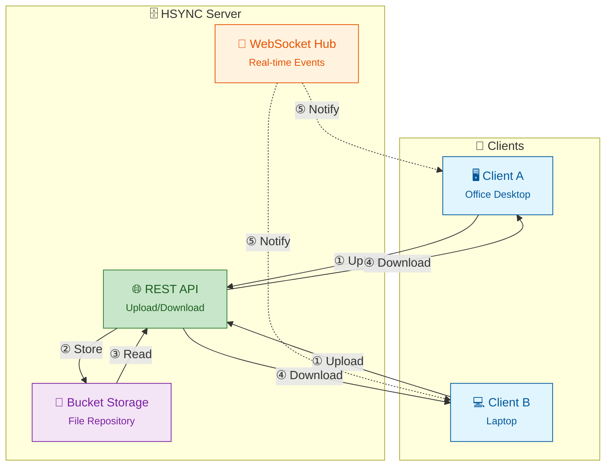

# HSYNC Server

> [!WARNING]
> **HSYNC manipulates files and directories** — it creates, overwrites, moves, and deletes data.
> Misconfiguration, software defects, or other unforeseen conditions may lead to **data loss or
> corruption**. **Use at your own risk and always keep verified, independent backups.**
> The software is provided "as is", without warranty of any kind — see the full
> [Disclaimer](#disclaimer) and [License](#license) below.


**HSYNC Server** is the central hub that keeps your files in sync across all your
devices. It stores shared folders, accepts file changes from any device, and
instantly notifies all other connected devices so they can pull the updates —
all over standard HTTP/HTTPS.

---

**Quick navigation:**
- **New to HSync?** Start with [Why HSYNC Server?](#why-hsync-server) and [Quick Start](#quick-start)
- **Looking for installation options?** Jump to [Install & quickstart](docs/README.md#install--quickstart)
- **Want to contribute?** See [Contributing](CONTRIBUTING.md)
- **Looking for detailed documentation?** Navigate to [docs/README.md](docs/README.md)

## Table of Contents

- [Why HSYNC Server?](#why-hsync-server)
- [Architecture Overview](#architecture-overview)
- [Features](#features)
- [Quick Start](#quick-start)
- [Command Line Options](#command-line-options)
- [Configuration](#configuration)
- [Documentation](#documentation)
- [Project Structure](#project-structure)
- [Version](#version)
- [License](#license)
- [Disclaimer](#disclaimer)

---

## Why HSYNC Server?

HSYNC is designed to synchronize files using **only the HTTP/HTTPS protocol**.
This makes it the ideal choice in environments where HTTP is the only protocol
allowed through firewalls, proxies, or network policies — a common constraint in
corporate networks, cloud environments, and restricted infrastructures.

| Tool | Required Protocol | Works over HTTP only? |
|------|-------------------|-----------------------|
| **HSYNC Server** | HTTP / HTTPS | ✅ **Yes** |
| rsync | SSH or rsync daemon | ❌ No |
| Syncthing | BEP (custom protocol) | ❌ No |
| FTP / FTPS | FTP | ❌ No |

**When to choose HSYNC Server:**
- 🏢 **Corporate networks** — only ports 80/443 are open through the firewall
- ☁️ **Cloud environments** — services behind load balancers or reverse proxies
- 🔒 **Restricted infrastructures** — SSH is disabled, VPNs unavailable
- 🌐 **Web-friendly setups** — route traffic through CDNs, WAFs, or API gateways

## Architecture Overview



## Features

- 🚀 REST API server for file upload/download
- 📁 Bucket management for file organization
- 🔄 WebSocket for real-time synchronization
- 🔐 API Key authentication (Bearer Token)
- ✅ SHA-256-based file integrity verification
- 📊 Integrated Prometheus metrics
- 🐳 Docker-ready deployment
- 🛡️ Rate limiting to prevent API abuse
- 🔗 Symbolic link synchronization support
- 📦 Per-bucket connection management for scalability
- ⏩ Resumable uploads (offset-based, with `upload-status` checks)
- 🪦 Deletion tombstones to prevent resurrecting files deleted on another peer
- ⏱️ Clock-synchronization endpoint for NTP-like client offset correction
- 🧩 Delta transfer (rsync-style block sync for large files)
- 🗜️ Zstandard (zstd) transfer compression

## Quick Start

```bash
cd hsync-server

# Build the Docker image
./docker.sh build

# Start the server (requires environment file)
./docker.sh start --env-file prod.env
```

See the [Deployment Guide](docs/deployment.md) for production setup with Docker
Compose, reverse proxy, and systemd.

## Command Line Options

```bash
hsync-server [options]
```

| Option | Description | Default |
|--------|-------------|---------|
| `--env-file PATH` | Load environment variables from file | - |
| `-p, --port PORT` | Server port | `8765` |
| `--log-level LEVEL` | Log level (debug, info, warning, error) | `info` |
| `--ssl` | Enable HTTPS/WSS (auto-generates certs if not provided) | disabled |
| `--ssl-cert FILE` | Path to SSL certificate (PEM format) | auto-generated |
| `--ssl-key FILE` | Path to SSL private key (PEM format) | auto-generated |
| `--ssl-cert-dir DIR` | Directory for auto-generated certificates | `./certs` |
| `-V, --version` | Show version | - |

## Configuration

The server is configured entirely through `HSYNC_*` environment variables.
See the [Environment Variables table](docs/README.md#environment-variables) in
the documentation for the complete list with defaults and descriptions.

Key variables:

| Variable | Description | Default |
|----------|-------------|---------|
| `HSYNC_API_KEY` | API key for authentication **(required)** | — |
| `HSYNC_PORT` | Server port | `8765` |
| `HSYNC_LOG_LEVEL` | Log level | `info` |
| `HSYNC_BUCKETS` | Directory for bucket data storage | `./buckets` |
| `HSYNC_MAX_UPLOAD_SIZE` | Maximum upload size in bytes | `10737418240` (10 GiB) |

> ⚠️ **Warning**: Multi-worker mode (`HSYNC_WORKERS > 1`) is NOT recommended.
> WebSocket connections and SHA-256 cache are not shared between workers.

## Documentation

| Document | What it covers |
| -------- | -------------- |
| [Documentation Index](docs/README.md) | System requirements, env vars, upgrade, client examples |
| [Deployment Guide](docs/deployment.md) | Docker Compose, reverse proxy, systemd, troubleshooting |
| [Operations Guide](docs/operations.md) | Backup/restore, upgrade, monitoring, performance |
| [API Reference](docs/api.md) | Complete REST + WebSocket API reference |
| [Architecture](docs/architecture.md) | Server components and module structure |
| [Sync Flow](docs/sync-flow.md) | Server-side sync flow: storage, events, tombstones |
| [FAQ](docs/faq.md) | Frequently asked questions and troubleshooting |
| [Contributing](CONTRIBUTING.md) | Development setup and contribution guidelines |
| [Security Policy](SECURITY.md) | Supported versions and how to report vulnerabilities |

### Related projects

- [HSYNC Common](https://github.com/albertobasso/hsync-common/blob/main/README.md) — Shared models, constants, and utilities
- [HSYNC Client](https://github.com/albertobasso/hsync-client/blob/main/README.md) — Sync client (Server Mode and LAN/P2P Mode)
- [HSYNC Desktop](https://github.com/albertobasso/hsync-desktop/blob/main/README.md) — Desktop GUI front-end
- [HSYNC Android](https://github.com/albertobasso/hsync-android/blob/main/README.md) — Android app

## Project Structure

```
hsync-server/
├── hsync_server/           # Main Python package
│   ├── main.py             # FastAPI application
│   ├── config.py           # Configuration (pydantic-settings)
│   ├── api/                # API endpoints
│   │   ├── files/          # File operations
│   │   ├── buckets.py      # Bucket management
│   │   ├── events.py       # WebSocket handler
│   │   └── health.py       # Health check + time endpoints
│   └── ...                 # Middleware, hashing, compression, etc.
├── docs/                   # Documentation
├── tests/                  # Test files
├── Dockerfile              # Docker image definition
├── docker.sh               # Docker management script
├── dev.env                 # Development environment template
├── prod.env                # Production environment template
└── pyproject.toml          # Poetry configuration
```

## Version

1.0.0

## License

[Mozilla Public License 2.0](LICENSE)

## Disclaimer

THE SOFTWARE IS PROVIDED "AS IS", WITHOUT WARRANTY OF ANY KIND, EXPRESS OR
IMPLIED, INCLUDING BUT NOT LIMITED TO THE WARRANTIES OF MERCHANTABILITY, FITNESS
FOR A PARTICULAR PURPOSE, AND NONINFRINGEMENT. Although the author has
implemented reasonable safety measures, IN NO EVENT SHALL THE AUTHOR OR
COPYRIGHT HOLDERS BE LIABLE FOR ANY CLAIM, DAMAGES, OR OTHER LIABILITY —
including, without limitation, any direct, indirect, incidental, special,
exemplary, or consequential damages, loss of data, or business interruption —
WHETHER IN AN ACTION OF CONTRACT, TORT, OR OTHERWISE, ARISING FROM, OUT OF, OR
IN CONNECTION WITH THE SOFTWARE OR THE USE OR OTHER DEALINGS IN THE SOFTWARE.

This disclaimer supplements, and does not replace, Sections 6 ("Disclaimer of
Warranty") and 7 ("Limitation of Liability") of the
[Mozilla Public License 2.0](LICENSE), which govern this software.
