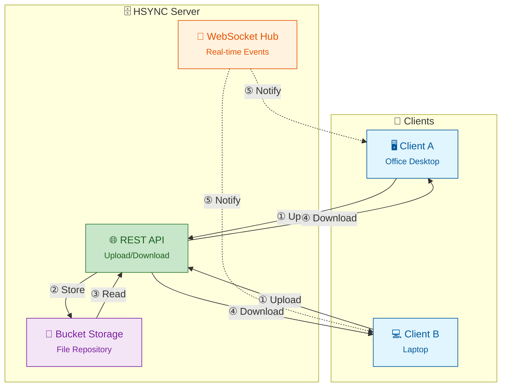

<p align="center">
  
</p>

# HSYNC Server

**HSYNC Server** is the central hub that keeps your files in sync in real-time
across all your devices. It stores shared folders (called **buckets**), accepts
file changes from any device via the [HSYNC Client](https://github.com/albertobasso/hsync-client),
and instantly notifies all other connected devices so they can pull the updates —
all over standard HTTP/HTTPS.

> A **bucket** is a named directory on the server that holds a set of
> synchronized files — think of it as a shared folder. You'll need the
> [HSYNC Client](https://github.com/albertobasso/hsync-client) on each device
> to actually sync files; the server is the storage and coordination hub.

>  👉 **Remember:** keep verified backups of your data before trying new
> synchronization tools. 😉

---

[](LICENSE)
[](https://www.python.org/)
[](https://www.docker.com/)

**Quick navigation:**
- **New to HSYNC?** Start with [Why HSYNC Server?](#why-hsync-server) and the [Getting Started guide](docs/getting-started.md)
- **Need another installation method?** See [Installation Alternatives](docs/installation-alternatives.md)
- **Want to contribute?** See [Contributing](CONTRIBUTING.md)
- **Looking for detailed documentation?** Navigate to [docs/README.md](docs/README.md)

## Why HSYNC Server?

HSYNC is designed to synchronize files using **only the HTTP/HTTPS protocol**.
This makes it the ideal choice in environments where HTTP is the only protocol
allowed through firewalls, proxies, or network policies — a common constraint in
corporate networks, cloud environments, and restricted infrastructures.

| Tool | Protocol | HTTP | Real-Time | Original Files | Architecture |
|------|----------|:---:|:---:|:---:|------|
| **HSYNC Server** | HTTP / HTTPS | ✅ | ✅ | ✅ | Client-Server + P2P |
| rsync | SSH or rsync daemon | ❌ | ❌ | ✅ | Client-Server |
| Syncthing | BEP (custom) | ❌ | ✅ | ✅ | P2P |
| Nextcloud | HTTP / HTTPS (WebDAV) | ✅ | ⚠️ ¹ | ✅ | Client-Server |
| Seafile | HTTP / HTTPS | ✅ | ⚠️ ¹ | ❌ ² | Client-Server |
| scp / sftp | SSH | ❌ | ❌ | ✅ | Client-Server |
| Unison | SSH or direct socket | ❌ | ❌ | ✅ | P2P |
| Rclone | S3, SFTP, etc. | ⚠️ ⁴ | ❌ | ⚠️ ³ | Client-Server |

> ¹ Local filesystem monitoring via desktop client; no native push notifications (WebSocket) like HSYNC.
> ² Seafile uses a proprietary block-based internal storage format; files are not directly accessible from the filesystem without the Seafile server.
> ³ Rclone with the `crypt` backend stores files in an opaque encrypted format; with other backends (e.g., SFTP, local) files remain in their original format.
> ⁴ Rclone's HTTP backend is read-only (download-only) and does not perform synchronization; Rclone's core operation relies on other protocols (S3, SFTP, etc.).

**When to choose HSYNC Server:**
- 🏢 **Corporate networks** — only ports 80/443 are open through the firewall
- ☁️ **Cloud environments** — services behind load balancers or reverse proxies
- 🔒 **Restricted infrastructures** — SSH is disabled, VPNs unavailable
- 🌐 **Web-friendly setups** — route traffic through CDNs, WAFs, or API gateways
- ⚡ **Real-time reactivity** — unlike traditional HTTP-based tools that rely on periodic polling, HSYNC reacts instantly to file changes using local watchdogs and event-driven WebSockets.

## Architecture Overview



## Features

- 🚀 REST API server for file upload/download
- 📁 Bucket management for file organization
- 🔄 WebSocket for real-time synchronization
- 🔐 API Key authentication (Bearer Token)
- ✅ SHA-256-based file integrity verification
- 📊 Integrated Prometheus metrics
- 🐳 Docker-ready deployment
- 🛡️ Rate limiting to prevent API abuse
- 🔗 Symbolic link synchronization support (preserves links as-is)
- 📦 Per-bucket connection management for scalability
- ⏩ Resumable uploads (offset-based, with `upload-status` checks)
- 🪦 Deletion tombstones to prevent resurrecting files deleted on another peer
- ⏱️ Clock-synchronization endpoint for NTP-like client offset correction
- 🧩 Delta transfer (rsync-style block sync for large files)
- 🗜️ Zstandard (zstd) transfer compression

## Getting Started

For a private LAN installation, use the single
[Getting Started guide](docs/getting-started.md). It downloads a pinned release,
generates secrets locally, starts the server with Docker Compose, and verifies
its health.

For an Internet-facing server, go directly to the
[Production Deployment Guide](docs/deployment.md). Source builds, direct Docker
commands, and Poetry are documented separately under
[Installation Alternatives](docs/installation-alternatives.md).

## Command Line Options

```bash
hsync-server [options]
```

| Option | Description | Default |
|--------|-------------|---------|
| `--env-file PATH` | Load environment variables from file | - |
| `-p, --port PORT` | Server port | `9753` |
| `--log-level LEVEL` | Log level (debug, info, warning, error) | `info` |
| `--no-color` | Disable colored log output | `false` |
| `--ssl` | Enable HTTPS/WSS (auto-generates certs if not provided) | disabled |
| `--ssl-cert FILE` | Path to SSL certificate (PEM format) | auto-generated |
| `--ssl-key FILE` | Path to SSL private key (PEM format) | auto-generated |
| `--ssl-cert-dir DIR` | Directory for auto-generated certificates | `{project_dir}/certs` |
| `-V, --version` | Show version | - |

## Configuration

The server is configured entirely through `HSYNC_*` environment variables.
See the [Environment Variables table](docs/README.md#environment-variables) in
the documentation for the complete list with defaults and descriptions.

Key variables:

| Variable | Description | Default |
|----------|-------------|---------|
| `HSYNC_API_KEY` | API key for authentication (required, min 16 chars) | — |
| `HSYNC_PORT` | Server port | `9753` |
| `HSYNC_LOG_LEVEL` | Log level | `info` |
| `HSYNC_BUCKETS` | Directory for bucket data storage | `./buckets` |
| `HSYNC_WORKERS` | Number of uvicorn worker processes | `1` |
| `HSYNC_MAX_UPLOAD_SIZE` | Maximum upload size in bytes | `10737418240` (10 GiB) |

> ⚠️ **Warning**: Multi-worker mode (`HSYNC_WORKERS > 1`) is NOT recommended.
> WebSocket connections and SHA-256 cache are not shared between workers.
> The server uses asynchronous I/O (FastAPI + asyncio), so a single worker
> can handle high concurrency efficiently without multiple processes.

## Documentation

| Document | What it covers |
| -------- | -------------- |
| [Documentation Index](docs/README.md) | System requirements, env vars, upgrade, client examples |
| [Getting Started](docs/getting-started.md) | Recommended private-LAN install and first connection |
| [Installation Alternatives](docs/installation-alternatives.md) | Manual Compose, direct Docker, source build, Poetry |
| [Deployment Guide](docs/deployment.md) | Docker Compose, reverse proxy, systemd, troubleshooting |
| [Operations Guide](docs/operations.md) | Backup/restore, upgrade, monitoring, performance |
| [API Reference](docs/api.md) | Complete REST + WebSocket API reference |
| [Architecture](docs/internal/architecture.md) | Server components and module structure |
| [Sync Flow](docs/sync-flow.md) | Server-side sync flow: storage, events, tombstones |
| [FAQ](docs/faq.md) | Frequently asked questions and troubleshooting |
| [Contributing](CONTRIBUTING.md) | Development setup and contribution guidelines |
| [Security Policy](SECURITY.md) | Supported versions and how to report vulnerabilities |

### Related projects

- [HSYNC Common](https://github.com/albertobasso/hsync-common/blob/main/README.md) - Shared models, constants, and utilities used by the client
- [HSYNC Client](https://github.com/albertobasso/hsync-client/blob/main/README.md) - Sync client (Server Mode and LAN/P2P Mode)
- [HSYNC Desktop](https://github.com/albertobasso/hsync-desktop/blob/main/docs/README.md) — Desktop client GUI front-end *(in development)*.
- [HSYNC Android](https://github.com/albertobasso/hsync-android/blob/main/docs/README.md) — Android client app *(in development)*.

> **Note:** The desktop GUI (`HSYNC Desktop`) and the Android app (`HSYNC Android`)
> are still under active development and are not yet ready for production use.

## Security

To report a vulnerability, please use GitHub's **Private Vulnerability Reporting**:

👉 **[Report a vulnerability](https://github.com/albertobasso/hsync-server/security/advisories/new)**

See our [Security Policy](SECURITY.md) for supported versions and hardening
recommendations.

## Disclaimer

> [!WARNING]
> **HSYNC manipulates files and directories** — it creates, overwrites, moves, and deletes data.
> Misconfiguration, software defects, or other unforeseen conditions may lead to **data loss or
> corruption**. **Use at your own risk and always keep verified, independent backups.**

THE SOFTWARE IS PROVIDED "AS IS", WITHOUT WARRANTY OF ANY KIND, EXPRESS OR IMPLIED, INCLUDING BUT NOT LIMITED TO THE WARRANTIES OF MERCHANTABILITY, FITNESS FOR A PARTICULAR PURPOSE, AND NONINFRINGEMENT. Although the author has implemented reasonable safety measures, IN NO EVENT SHALL THE AUTHOR OR COPYRIGHT HOLDERS BE LIABLE FOR ANY CLAIM, DAMAGES, OR OTHER LIABILITY — including, without limitation, any direct, indirect, incidental, special, exemplary, or consequential damages, loss of data, or business interruption — WHETHER IN AN ACTION OF CONTRACT, TORT, OR OTHERWISE, ARISING FROM, OUT OF, OR IN CONNECTION WITH THE SOFTWARE OR THE USE OR OTHER DEALINGS IN THE SOFTWARE.

This disclaimer supplements, and does not replace, Sections 6 ("Disclaimer of Warranty") and 7 ("Limitation of Liability") of the [Mozilla Public License 2.0](LICENSE), which govern this software.
