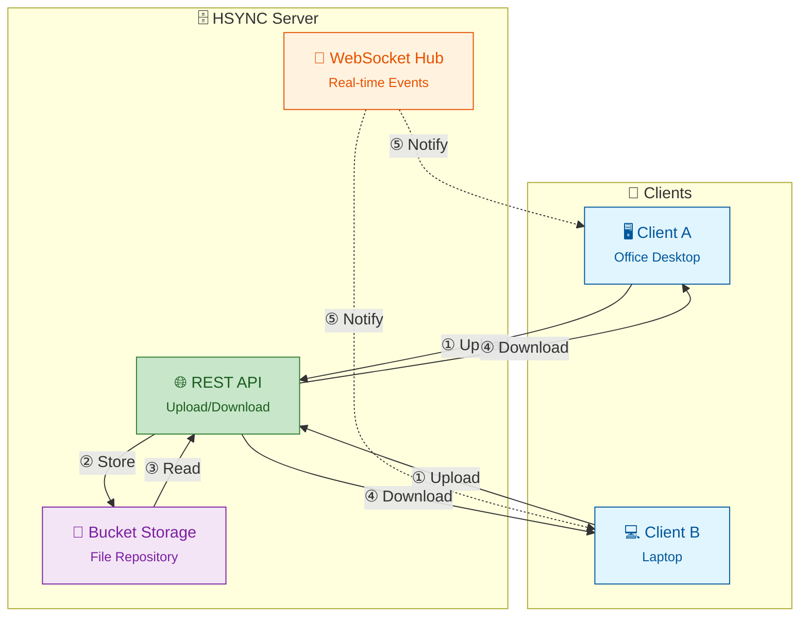

<p align="center">
  
</p>

# HSYNC Server

**HSYNC Server** is the central hub that keeps your files in sync in real-time
across all your devices. It stores shared folders (called **buckets**), accepts
file changes from any device via the [HSYNC Client](https://github.com/albertsdk/hsync-client),
and instantly notifies all other connected devices so they can pull the updates —
all over standard HTTP/HTTPS.

It scales with your setup — from a laptop or NAS on a small LAN to a VPS serving several offices — and stays entirely self-hosted: the hub, the storage and the credentials remain yours, with your files stored in their original format.

> A **bucket** is a named directory on the server that holds a set of
> synchronized files — think of it as a shared folder. You'll need the
> [HSYNC Client](https://github.com/albertsdk/hsync-client) on each device
> to actually sync files; the server is the storage and coordination hub.

> **The server is optional:** devices that share a network segment can sync
> directly, peer-to-peer, with the client’s
> [p2p Mode](https://github.com/albertsdk/hsync-client/blob/main/docs/p2p-mode.md).

> 👉 **Operational Advisory:** As with any automated filesystem mutation utility, administrators are strongly advised to maintain validated, independent backups prior to initial deployment in production environments.

---

[](LICENSE)
[](https://github.com/albertsdk/hsync-server/actions/workflows/ci.yml)
[](https://github.com/albertsdk/hsync-server/releases/latest)
[](https://www.python.org/)
[](https://github.com/albertsdk/hsync-server/pkgs/container/hsync-server)

**Quick navigation:**
- **New to HSYNC Server?** Start with [What you can do](#what-you-can-do-with-hsync-server) and the [Getting Started guide](docs/getting-started.md)
- **Do you need the server?** See [Do you need the server?](#do-you-need-the-server) — and the client's [p2p Mode](https://github.com/albertsdk/hsync-client/blob/main/docs/p2p-mode.md) alternative
- **Need another installation method?** See the [Getting Started guide](docs/getting-started.md)
- **Want to contribute?** See [Contributing](CONTRIBUTING.md)
- **Looking for detailed documentation?** Navigate to [docs/README.md](docs/README.md)

## What you can do with HSYNC Server

* **Keep every device in sync through one hub** — office desktops, laptops and servers meet on the server, each with its own local folder.
* **Keep a central, always-available copy** — the current state of every bucket lives on your disk as plain directories, ready for your usual backup tools.
* **Share folders with a team** — accounts with per-bucket roles (`admin`, `owner`, `member`) let different people access different folders on the same server.
* **Serve devices across networks** — everything rides HTTP/HTTPS, so clients reach the hub through firewalls and reverse proxies.
* **Publish read-only data** — deliver updates to branch or kiosk devices that only download.
* **Operate it your way** — Docker Compose for a private LAN, the deployment guide for Internet-facing setups, Prometheus metrics and structured logs for monitoring.

## Do you need the server?

A server is not always necessary. **You need it when** your devices are on different networks, you want a central copy on hardware you own, or you manage many devices and accounts. **You don't when** all your devices share one network: the client's [p2p Mode](https://github.com/albertsdk/hsync-client/blob/main/docs/p2p-mode.md) syncs them directly, with no server at all. Either way the client is what performs the sync — the server is the meeting point and the storage hub.

## Getting started

On a machine with Docker (Linux or macOS), install the latest stable release — the installer sets up Docker Compose, generates the secrets and a self-signed certificate, and serves `https://localhost:9753`:

```bash
curl -fsSL https://github.com/albertsdk/hsync-server/releases/latest/download/install.sh | bash
```

Verify it is healthy:

```bash
curl --insecure https://localhost:9753/health && echo "SERVER OK!"
```

To reach the server from other devices on a private LAN, pass its LAN address on the **first** install (`curl -fsSL https://github.com/albertsdk/hsync-server/releases/latest/download/install.sh | bash -s -- --bind-address LAN_IP`): the persistent certificate is generated for that address. Prefer no containers? Use [Getting Started — From source](docs/getting-started-source.md).

Then create the accounts and the buckets and connect the clients — the [Getting Started guide](docs/getting-started.md) shows the exact commands for each path, and [Roles and Permissions](docs/roles-and-permissions.md) covers accounts, roles and keys. For an Internet-facing server, continue with the [Production Deployment Guide](docs/deployment.md).

## Why HSYNC Server?

HSYNC is designed to synchronize files **in real-time** using **only the HTTP/HTTPS protocol**.
This makes it the ideal choice in environments where HTTP is the only protocol
allowed through firewalls, proxies, or network policies — a common constraint in
corporate networks, cloud environments, and restricted infrastructures.<br><br>
The table below compares HSYNC with common alternatives on five dimensions.<br>
**Native Storage** means the tool stores your files in their original format,
directly browsable on disk — no proprietary containers, block stores, or
opaque internal formats.

| Tool | Protocol | HTTP | Real-Time | Native Storage | Architecture |
|------|----------|:---:|:---:|:---:|------|
| **HSYNC Server** | HTTP / HTTPS | ✅ | ✅ | ✅ | Client-Server + P2P |
| rsync | SSH or rsync daemon | ❌ | ❌ | ✅ | Client-Server |
| Syncthing | BEP (custom) | ❌ | ✅ | ✅ | P2P |
| Nextcloud | HTTP / HTTPS (WebDAV) | ✅ | ⚠️ ¹ | ✅ | Client-Server |
| Seafile | HTTP / HTTPS | ✅ | ⚠️ ¹ | ❌ ² | Client-Server |
| scp / sftp | SSH | ❌ | ❌ | ✅ | Client-Server |
| Unison | SSH or direct socket | ❌ | ❌ | ✅ | P2P |
| Rclone | S3, SFTP, etc. | ⚠️ ⁴ | ❌ | ⚠️ ³ | Client-Server |

> ¹ Local filesystem monitoring via desktop client; no native push notifications (WebSocket) like HSYNC.<br>
> ² Seafile uses a proprietary block-based internal storage format; files are not directly accessible from the filesystem without the Seafile server.<br>
> ³ Rclone with the `crypt` backend stores files in an opaque encrypted format; with other backends (e.g., SFTP, local) files remain in their original format.<br>
> ⁴ Rclone's HTTP backend is read-only (download-only) and does not perform synchronization; Rclone's core operation relies on other protocols (S3, SFTP, etc.).

**When to choose HSYNC Server:**
- 🏢 **Corporate networks** — only ports 80/443 are open through the firewall
- ☁️ **Cloud environments** — services behind load balancers or reverse proxies
- 🔒 **Restricted infrastructures** — SSH is disabled, VPNs unavailable
- 🌐 **Web-friendly setups** — route traffic through CDNs, WAFs, or API gateways
- ⚡ **Real-time reactivity** — unlike traditional HTTP-based tools that rely on periodic polling, HSYNC reacts instantly to file changes using local watchdogs and event-driven WebSockets.
- 🏠 **Self-hosted by design** — you operate the hub, the storage and the credentials: buckets are plain directories on your own filesystem and access is per-account with roles, with no third-party service in the data path.

## Architecture Overview



## Features

- 🚀 REST API server for file upload/download
- 📁 Bucket management for file organization
- 🔄 WebSocket for real-time synchronization
- 🔐 Account token authentication (`hs_<id>_<secret>`; Bearer token for REST, first-frame for WebSocket)
- ✅ SHA-256-based file integrity verification
- 📊 Integrated Prometheus metrics
- 🐳 Docker-ready deployment
- 🛡️ Rate limiting to prevent API abuse
- 🔗 Symbolic link synchronization support (preserves links as-is)
- 📦 Per-bucket connection management for scalability
- ⏩ Resumable uploads (offset-based, with `upload-status` checks)
- 🪦 Deletion tombstones to prevent resurrecting files deleted on another peer
- ⏱️ Clock-synchronization endpoint for NTP-like client offset correction
- 🧩 Delta transfer (rsync-style block sync for large files)
- 🗜️ Zstandard (zstd) transfer compression

## Command Line Options

```bash
hsync-server [options]
```

| Option | Description | Default |
|--------|-------------|---------|
| `--env-file PATH` | Load environment variables from file | - |
| `-p, --port PORT` | Server port | `9753` |
| `--log-level LEVEL` | Log level (debug, info, warning, error, critical) | `info` |
| `--no-color` | Disable colored log output | `false` |
| `--ssl` | Enable HTTPS/WSS (auto-generates certs if not provided) | disabled |
| `--ssl-cert FILE` | Path to SSL certificate (PEM format) | auto-generated |
| `--ssl-key FILE` | Path to SSL private key (PEM format) | auto-generated |
| `--ssl-cert-dir DIR` | Directory for auto-generated certificates | `{project_dir}/certs` |
| `-V, --version` | Show version | - |

## Building a Standalone Binary

`./compile.sh` freezes the server into a self-contained executable with
[PyInstaller](https://pyinstaller.org/) — no Python installation is required to
run the result.

```bash
./compile.sh                    # host OS/arch → dist/<os>-<arch>/hsync-server
./compile.sh --clean            # clean artifacts and rebuild
./compile.sh --target deb       # Debian/Ubuntu .deb for the host arch
./compile.sh --target deb-all   # .deb for amd64, arm64 and armhf (Docker + qemu)
./compile.sh --target rpi       # Raspberry Pi OS armhf + arm64 (Docker + qemu)
```

The `native` target uses the project virtualenv; install the PyInstaller build
group once with `poetry install --with build`. The `deb` target produces
`dist/deb/hsync-server_<ver>_<arch>.deb` (installable with `dpkg -i`); `deb-all`
cross-builds the three Debian architectures inside Docker. The `rpi` target
builds Raspberry Pi OS 32-bit (`armhf`) and 64-bit (`arm64`) executables into
`dist/rpi/<arch>/hsync-server` inside Docker (cross-architecture emulation via
`qemu-user-static`). See [Contributing](CONTRIBUTING.md) for the full details.

## Configuration

The server is configured entirely through `HSYNC_*` environment variables.
See the [Environment Variables table](docs/README.md#environment-variables) in
the documentation for the complete list with defaults and descriptions.

Clients authenticate with per-account tokens (`hs_<id>_<secret>`); see
[Authentication](docs/authentication.md) for the auth flow and the bootstrap
admin account.

Key variables:

| Variable | Description | Default |
|----------|-------------|---------|
| `HSYNC_ADMIN_KEY` | Bootstrap admin secret (64 hex chars). If unset, the server generates one and prints the admin account token once at startup | auto-generated |
| `HSYNC_PORT` | Server port | `9753` |
| `HSYNC_LOG_LEVEL` | Log level | `info` |
| `HSYNC_BUCKETS` | Directory for bucket data storage | `<app>/buckets` (absolute, resolved at startup) |
| `HSYNC_STATE_DIR` | Directory for the per-bucket state DBs and the global auth DB (causal versions, tombstones, accounts) | `<app>/state` (absolute, resolved at startup) |
| `HSYNC_WORKERS` | Number of uvicorn worker processes | `1` |
| `HSYNC_MAX_UPLOAD_SIZE` | Maximum upload size in bytes | `10737418240` (10 GiB) |

> ⚠️ **Warning**: Multi-worker mode (`HSYNC_WORKERS > 1`) is NOT recommended.
> WebSocket connections, the SHA-256 cache, and the in-memory rate limiter are
> not shared between workers. The server uses asynchronous I/O (FastAPI +
> asyncio), so a single worker can handle high concurrency efficiently
> without multiple processes.

## Documentation

| Document | What it covers |
| -------- | -------------- |
| [Documentation Index](docs/README.md) | System requirements, env vars, upgrade, client examples |
| [Getting Started](docs/getting-started.md) | Chooser for the four install methods and first connection |
| [Deployment Guide](docs/deployment.md) | Docker Compose, reverse proxy, systemd, troubleshooting |
| [Operations Guide](docs/operations.md) | Backup/restore, upgrade, monitoring, performance |
| [API Reference](docs/api.md) | Complete REST + WebSocket API reference |
| [Architecture](docs/internal/architecture.md) | Server components and module structure |
| [Sync Flow](docs/sync-flow.md) | Server-side sync flow: storage, events, tombstones |
| [FAQ](docs/faq.md) | Frequently asked questions and troubleshooting |
| [Contributing](CONTRIBUTING.md) | Development setup and contribution guidelines |
| [Security Policy](SECURITY.md) | Supported versions and how to report vulnerabilities |

### Associated Ecosystem Components

- [HSYNC Common](https://github.com/albertsdk/hsync-common/blob/main/README.md) - Shared models, constants, and utilities used by the client
- [HSYNC Client](https://github.com/albertsdk/hsync-client/blob/main/README.md) - Sync client (Server Mode and p2p Mode)
- [HSYNC Desktop](https://github.com/albertsdk/hsync-desktop/blob/main/docs/README.md) — Desktop client GUI front-end *(in development)*.
- [HSYNC Android](https://github.com/albertsdk/hsync-android/blob/main/docs/README.md) — Android client app *(in development)*.

> **Note:** The desktop GUI (`HSYNC Desktop`) and the Android app (`HSYNC Android`)
> are still under active development and are not yet ready for production use.

## Security & Vulnerability Reporting

To report a vulnerability, please use GitHub's **Private Vulnerability Reporting**:

👉 **[Report a vulnerability](https://github.com/albertsdk/hsync-server/security/advisories/new)**

See our [Security Policy](SECURITY.md) for supported versions and hardening
recommendations.

## A note from the maintainer

HSYNC is a passion project started by Alberto Basso. It is built in spare time,
with love. Please remember this when you interact with the project: everyone
involved is doing our best to build something great together, but it is not a
paid, full-time job for any of us.

## Disclaimer

> [!WARNING]
> **HSYNC manipulates files and directories** — it creates, overwrites, moves, and deletes data.
> Misconfiguration, software defects, or other unforeseen conditions may lead to **data loss or
> corruption**. **Use at your own risk and always keep verified, independent backups.**

THE SOFTWARE IS PROVIDED "AS IS", WITHOUT WARRANTY OF ANY KIND, EXPRESS OR IMPLIED, INCLUDING BUT NOT LIMITED TO THE WARRANTIES OF MERCHANTABILITY, FITNESS FOR A PARTICULAR PURPOSE, AND NONINFRINGEMENT. Although the author has implemented reasonable safety measures, IN NO EVENT SHALL THE AUTHOR OR COPYRIGHT HOLDERS BE LIABLE FOR ANY CLAIM, DAMAGES, OR OTHER LIABILITY — including, without limitation, any direct, indirect, incidental, special, exemplary, or consequential damages, loss of data, or business interruption — WHETHER IN AN ACTION OF CONTRACT, TORT, OR OTHERWISE, ARISING FROM, OUT OF, OR IN CONNECTION WITH THE SOFTWARE OR THE USE OR OTHER DEALINGS IN THE SOFTWARE.

This disclaimer supplements, and does not replace, Sections 6 ("Disclaimer of Warranty") and 7 ("Limitation of Liability") of the [Mozilla Public License 2.0](LICENSE), which govern this software.

## License

Distributed under the [Mozilla Public License 2.0](LICENSE).
