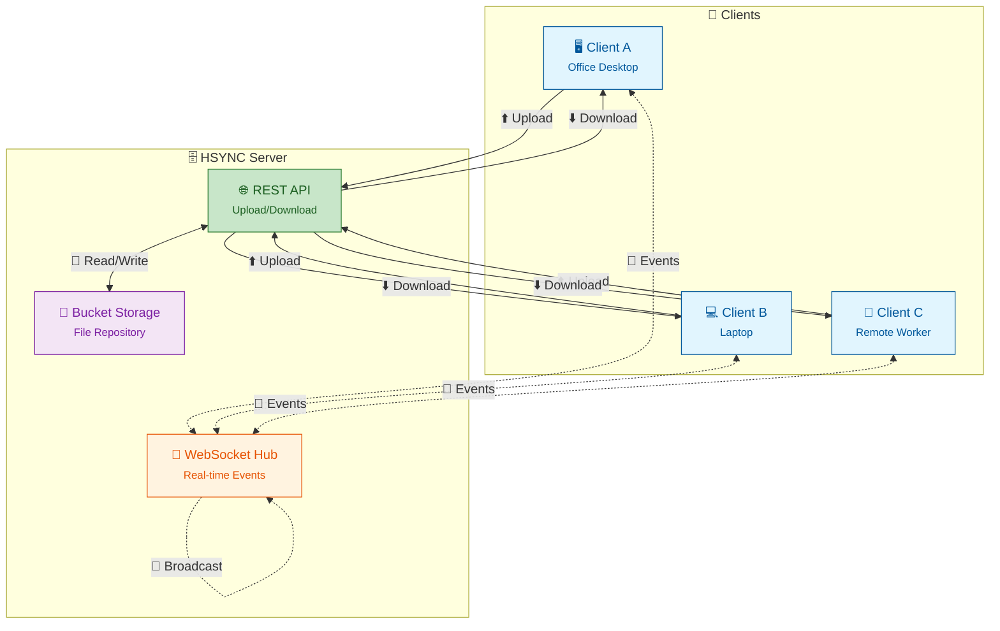

# HSYNC Server

HTTP-based file synchronization server built with FastAPI, featuring WebSocket support for real-time events.

## Architecture Overview



**Legend:**
- 🟦 **Clients**: Desktop, laptop, or remote machines running HSYNC Client
- 🟩 **REST API**: HTTP endpoints for file upload/download operations
- 🟧 **WebSocket Hub**: Real-time event distribution to connected clients
- 🟪 **Bucket Storage**: Server-side file repository organized by buckets

## Features

- 🚀 REST API server for file upload/download
- 📁 Bucket management for file organization
- 🔄 WebSocket for real-time synchronization
- 🔐 API Key authentication (Bearer Token)
- ✅ MD5-based file integrity verification
- 📊 Integrated Prometheus metrics
- 🐳 Docker-ready deployment
- 🛡️ Rate limiting to prevent API abuse
- 🔗 Symbolic link synchronization support
- 📦 Per-bucket connection management for scalability

## Requirements

- Docker

## Quick Start

```bash
cd hsync-server

# Build the Docker image
./docker.sh build

# Start the server (requires environment file)
./docker.sh start --env-file prod.env
```

## Configuration

The server uses environment variables for configuration. Create a `.env` file or use the provided `dev.env`/`prod.env` templates:

| Variable | Description | Default |
|----------|-------------|---------|
| `HSYNC_API_KEY` | API key for authentication (required) | (empty) |
| `HSYNC_PORT` | Server port | `8765` |
| `HSYNC_LOG_LEVEL` | Log level (`debug`, `info`, `warning`, `error`, `critical`) | `info` |
| `HSYNC_WORKERS` | Number of uvicorn workers | `1` |
| `HSYNC_TZ` | Timezone in IANA format (e.g., `Europe/Rome`) | `UTC` |

> ⚠️ **Warning**: Multi-worker mode (`HSYNC_WORKERS > 1`) is NOT recommended. WebSocket connections and MD5 cache are not shared between workers.

## Docker

The server is designed to run in Docker. Use the `docker.sh` script for all operations:

### Commands

```bash
./docker.sh build       # Build the Docker image
./docker.sh start       # Start the container
./docker.sh stop        # Stop the container
./docker.sh restart     # Restart the container
./docker.sh status      # Show container status
./docker.sh logs        # Show container logs
./docker.sh logs -f     # Follow container logs
./docker.sh shell       # Open a shell in the running container
./docker.sh clean       # Remove container and image
```

### Using Environment Files

```bash
# Development
./docker.sh start --env-file dev.env

# Production
./docker.sh start --env-file prod.env
```

### Environment Variables

You can also set environment variables directly:

```bash
HSYNC_API_KEY="your-secret-key" ./docker.sh start
```

### Debug Container

```bash
docker run --rm -it --entrypoint=/bin/sh hsync:0.1.0
```

## REST API

> 📖 For detailed API documentation, see [docs/api.md](docs/api.md)

### Buckets

| Method | Endpoint | Description |
|--------|----------|-------------|
| `GET` | `/api/v1/buckets/{bucket}` | Get bucket information |
| `POST` | `/api/v1/buckets?bucket={name}` | Create a new bucket |
| `DELETE` | `/api/v1/buckets/{bucket}` | Delete a bucket |

### Files

| Method | Endpoint | Description |
|--------|----------|-------------|
| `GET` | `/api/v1/buckets/{bucket}/files` | List files in bucket |
| `POST` | `/api/v1/buckets/{bucket}/files` | Upload file (multipart/form-data) |
| `GET` | `/api/v1/buckets/{bucket}/files/download?filename={path}` | Download file |
| `DELETE` | `/api/v1/buckets/{bucket}/files` | Delete file |

### Upload Parameters

| Field | Type | Description |
|-------|------|-------------|
| `cid` | string | Client ID |
| `file` | file | File to upload |
| `path` | string | Relative path in bucket |
| `ctime` | string | Creation time |
| `mtime` | string | Modification time |
| `md5sum` | string | MD5 checksum |
| `permissions` | string | File permissions (e.g., `-rw-rw-r--`) |

## WebSocket

### Endpoint

```
ws://host:8765/api/v1/buckets/{bucket}/events/{cid}
```

### Authentication

After connecting, the client must send an authentication message:

```json
{"type": "auth", "token": "your-api-key"}
```

Server responds with:
```json
{"type": "auth", "status": "ok"}
```

If authentication fails, the connection is closed with an appropriate error code.

### Supported Events

| Event | Description |
|-------|-------------|
| `added` | File/directory added |
| `modified` | File/directory modified |
| `renamed` | File/directory renamed |
| `deleted` | File/directory deleted |
| `symlink` | Symbolic link created/modified |

### Message Format

```json
{
  "name": "added|modified|renamed|deleted|symlink",
  "src": { "filepath": "...", "name": "...", ... },
  "dst": { ... }  // only for 'renamed'
}
```

## Rate Limiting

The server implements rate limiting to prevent API abuse:

| Endpoint | Limit |
|----------|-------|
| Upload (`/api/v1/buckets/{bucket}/files` POST) | 50 requests/minute |
| Download (`/api/v1/buckets/{bucket}/files/download`) | 200 requests/minute |
| Files list (`/api/v1/buckets/{bucket}/files` GET) | 100 requests/minute |
| Other endpoints | 100 requests/minute |

When rate limit is exceeded, the server returns HTTP 429 (Too Many Requests).

## Health Check

```bash
curl http://localhost:8765/health
```

## Prometheus Metrics

```bash
curl http://localhost:8765/metrics
```

## Documentation

- [Architecture](docs/architecture.md) - System architecture and component overview
- [API Reference](docs/api.md) - Complete REST and WebSocket API documentation
- [Synchronization Flow](docs/sync-flow.md) - How file synchronization works

## Project Structure

```
hsync-server/
├── hsync_server/           # Main Python package
│   ├── __init__.py
│   ├── __main__.py         # Entry point: python -m hsync_server
│   ├── config.py           # Configuration
│   ├── logger.py           # Logging configuration
│   ├── main.py             # FastAPI application
│   ├── routers.py          # Router configuration
│   ├── hashes.py           # MD5 hash caching
│   ├── rate_limiter.py     # Rate limiting configuration
│   ├── api/                # API endpoints
│   │   ├── __init__.py
│   │   ├── utils.py        # API utilities
│   │   ├── events.py       # WebSocket handler
│   │   ├── files.py        # REST API files/buckets
│   │   └── health.py       # Health check
│   └── models/             # Data models
│       ├── __init__.py
│       ├── dir.py
│       ├── event.py
│       ├── file.py
│       ├── symlink.py      # Symbolic link model
│       └── sync_action.py
├── docs/                   # Documentation
│   ├── architecture.md
│   ├── api.md
│   └── sync-flow.md
├── tests/                  # Test files
├── buckets/                # File storage (created at runtime)
├── Dockerfile
├── docker.sh               # Docker management script
├── dev.env                 # Development environment template
├── prod.env                # Production environment template
├── pyproject.toml
└── poetry.lock
```

## Authentication

All API requests (except `/health` and `/metrics`) require the header:

```
Authorization: Bearer {HSYNC_API_KEY}
```

## Version

0.1.0
