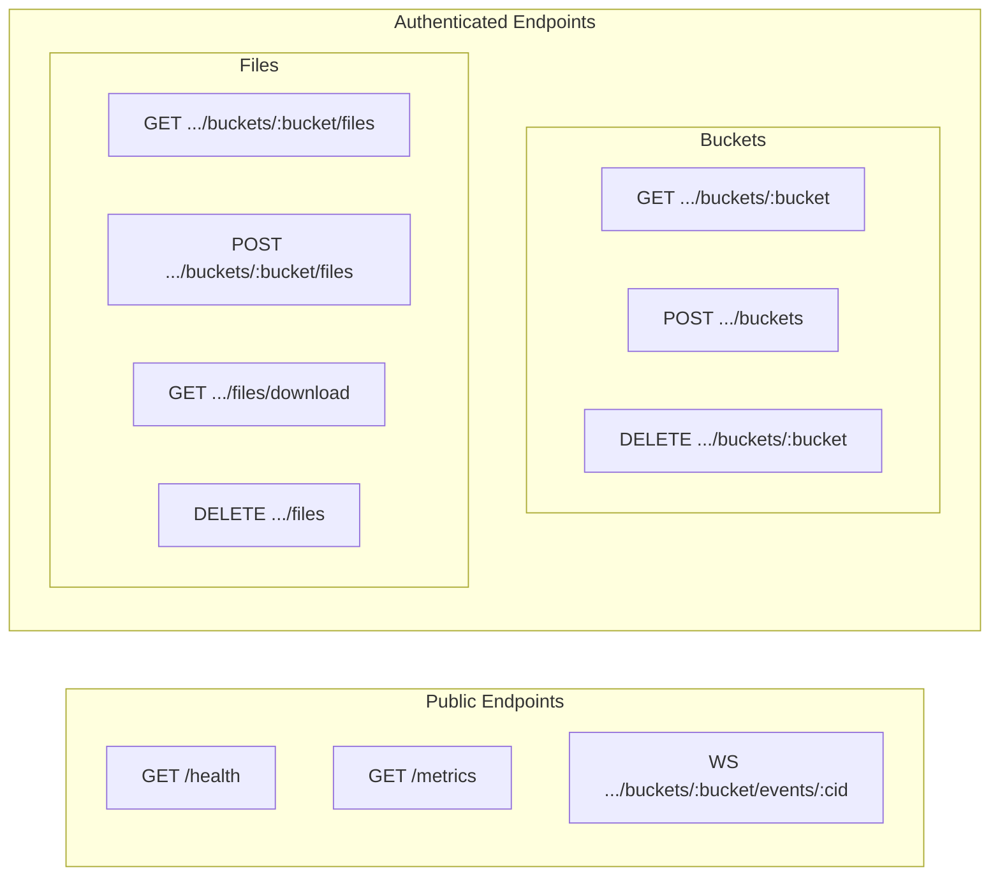
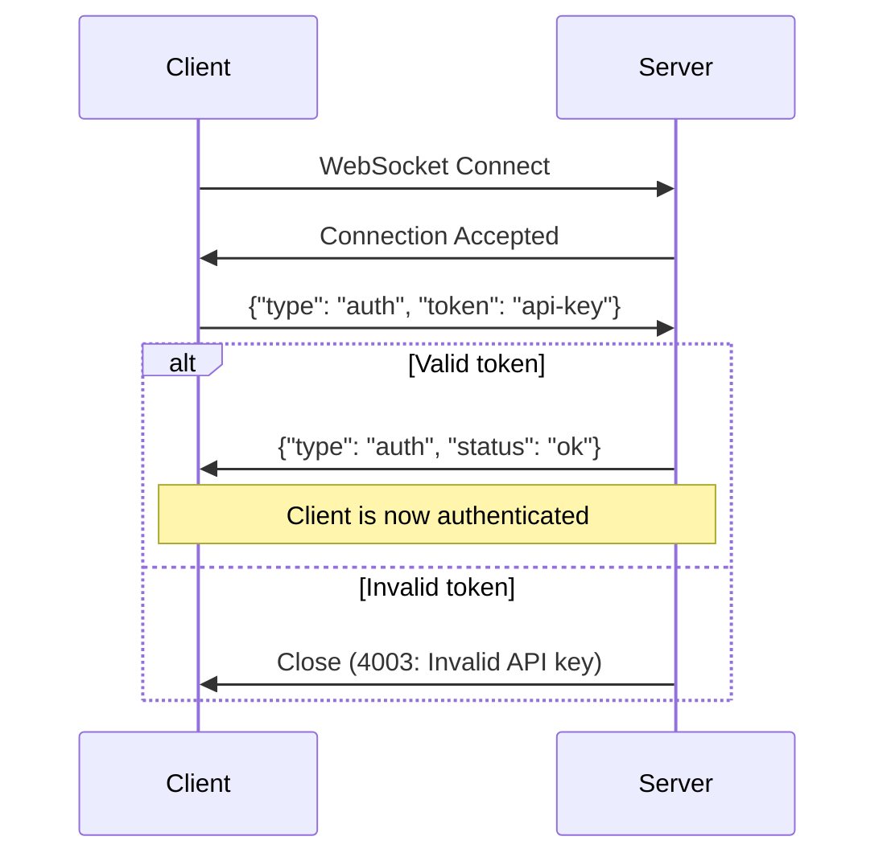

# HSYNC Server API Reference

This document provides a complete reference for the HSYNC Server REST and WebSocket APIs.

> **Note**: Diagrams are written in Mermaid. If they don't render, run `./generate-diagrams.sh` to generate PNG images in the `images/` directory.

## API Overview




## Authentication

All authenticated endpoints require the `Authorization` header:

```
Authorization: Bearer {HSYNC_API_KEY}
```

## REST API Endpoints

### Buckets

| Method | Endpoint | Description | Rate Limit |
|--------|----------|-------------|------------|
| `GET` | `/api/v1/buckets/{bucket}` | Get bucket information | 100/min |
| `POST` | `/api/v1/buckets?bucket={name}` | Create a new bucket | 100/min |
| `DELETE` | `/api/v1/buckets/{bucket}` | Delete a bucket | 100/min |

### Files

| Method | Endpoint | Description | Rate Limit |
|--------|----------|-------------|------------|
| `GET` | `/api/v1/buckets/{bucket}/files` | List files in bucket | 100/min |
| `POST` | `/api/v1/buckets/{bucket}/files` | Upload a file | 50/min |
| `GET` | `/api/v1/buckets/{bucket}/files/download?filename={path}` | Download a file | 200/min |
| `DELETE` | `/api/v1/buckets/{bucket}/files` | Delete a file | 100/min |

### Monitoring

| Method | Endpoint | Description | Auth |
|--------|----------|-------------|------|
| `GET` | `/health` | Health check | No |
| `GET` | `/metrics` | Prometheus metrics | No |

## Request/Response Examples

### Upload File

```http
POST /api/v1/buckets/mybucket/files HTTP/1.1
Authorization: Bearer your-api-key
Content-Type: multipart/form-data

cid=client-123
file=@document.pdf
path=documents/
ctime=2024-01-15T10:30:00Z
mtime=2024-01-15T10:30:00Z
md5sum=d41d8cd98f00b204e9800998ecf8427e
permissions=-rw-rw-r--
```

**Response (201 Created):**
```json
{
  "info": "File uploaded successfully",
  "file": "mybucket/documents/document.pdf"
}
```

### List Files

```http
GET /api/v1/buckets/mybucket/files?sync_order=mtime HTTP/1.1
Authorization: Bearer your-api-key
```

**Response (200 OK):**
```json
[
  {
    "filepath": "documents/file1.txt",
    "name": "file1.txt",
    "size": 1024,
    "mtime": "2024-01-15T10:30:00Z",
    "ctime": "2024-01-15T10:00:00Z",
    "md5sum": "d41d8cd98f00b204e9800998ecf8427e",
    "permissions": "-rw-rw-r--"
  }
]
```

## WebSocket API

### Endpoint

```
ws://host:8765/api/v1/buckets/{bucket}/events/{cid}
```

### Authentication Flow




### Event Types

| Event | Description | Payload |
|-------|-------------|---------|
| `added` | File/directory created | `src: File\|Dir` |
| `modified` | File/directory modified | `src: File\|Dir` |
| `renamed` | File/directory renamed | `src: File\|Dir, dst: File\|Dir` |
| `deleted` | File/directory deleted | `src: File\|Dir` |
| `symlink` | Symbolic link created | `src: Symlink` |

### Event Message Format

```json
{
  "cid": "client-123",
  "bucket": "mybucket",
  "name": "added",
  "src": {
    "type": "file",
    "filepath": "documents/file.txt",
    "name": "file.txt",
    "size": 1024,
    "mtime": "2024-01-15T10:30:00Z",
    "md5sum": "d41d8cd98f00b204e9800998ecf8427e"
  }
}
```

## Error Responses

| Status | Description |
|--------|-------------|
| 400 | Bad Request - Invalid parameters |
| 401 | Unauthorized - Invalid API key |
| 403 | Forbidden - Missing API key |
| 404 | Not Found - Resource not found |
| 409 | Conflict - File already exists |
| 429 | Too Many Requests - Rate limit exceeded |
| 500 | Internal Server Error |

