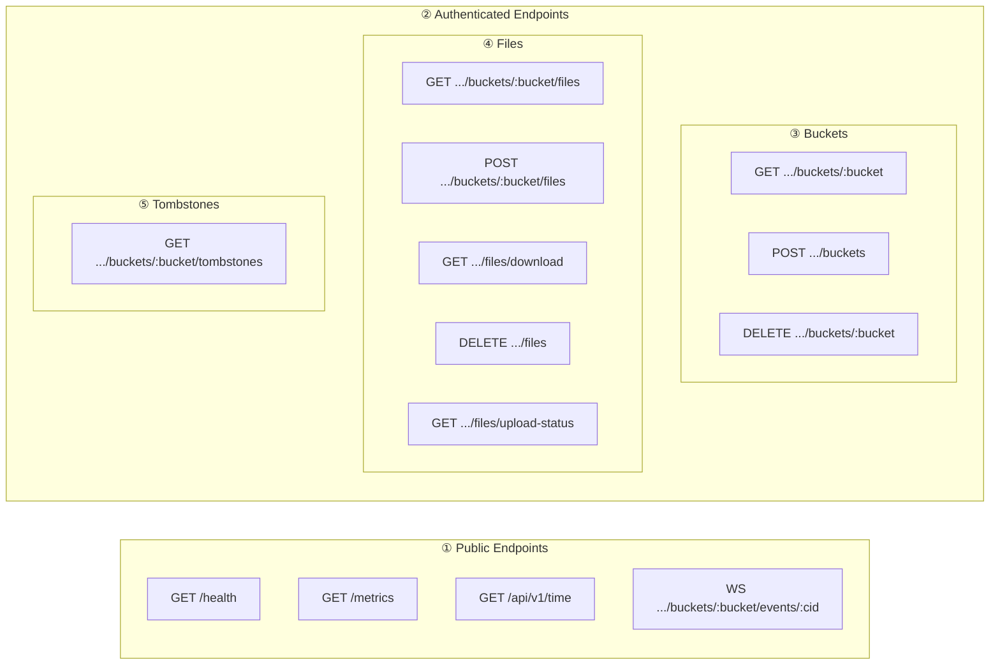
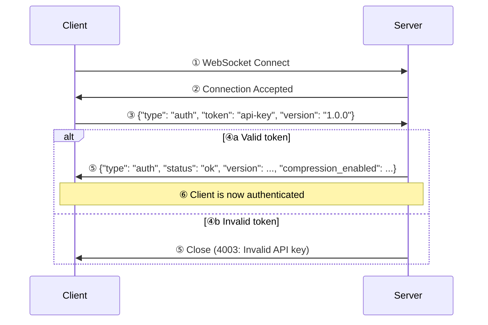

# HSYNC Server API Reference

This document provides a complete reference for the HSYNC Server REST and WebSocket APIs.

## API Overview



## Authentication

All authenticated endpoints require the `Authorization` header:

```
Authorization: Bearer {HSYNC_API_KEY}
```

## REST API Endpoints

> Rate limits are per-IP defaults and configurable via environment variables
> (see [README → Environment Variables](README.md#environment-variables)).

### Buckets

| Method | Endpoint | Description | Rate Limit |
|--------|----------|-------------|------------|
| `GET` | `/api/v1/buckets/{bucket}` | Get bucket information | 500/min |
| `POST` | `/api/v1/buckets?bucket={name}` | Create a new bucket | 500/min |
| `DELETE` | `/api/v1/buckets/{bucket}` | Delete a bucket | 500/min |

### Files

| Method | Endpoint | Description | Rate Limit |
|--------|----------|-------------|------------|
| `GET` | `/api/v1/buckets/{bucket}/files` | List files in bucket | 500/min |
| `POST` | `/api/v1/buckets/{bucket}/files` | Upload a file (resumable) | 200/min |
| `GET` | `/api/v1/buckets/{bucket}/files/download?filename={path}` | Download a file | 1000/min |
| `GET` | `/api/v1/buckets/{bucket}/files/upload-status?filename={path}` | Check resumable-upload status (offset) | 500/min |
| `DELETE` | `/api/v1/buckets/{bucket}/files` | Delete a file | 500/min |

### Tombstones

Deletion markers let peers that were offline at deletion time avoid resurrecting
files during a full reconciliation.

| Method | Endpoint | Description | Rate Limit |
|--------|----------|-------------|------------|
| `GET` | `/api/v1/buckets/{bucket}/tombstones` | List deletion markers for a bucket | 500/min |

### Delta Transfer

Delta transfer endpoints enable rsync-style block-level synchronization for
efficient file updates. Instead of transferring entire files, only the changed
blocks are sent, significantly reducing bandwidth usage for large files with
small changes.

| Method | Endpoint | Description | Rate Limit |
|--------|----------|-------------|------------|
| `GET` | `/api/v1/buckets/{bucket}/files/delta/signatures?path={path}` | Get block signatures of a file (for upload delta) | 100/min |
| `POST` | `/api/v1/buckets/{bucket}/files/delta/signatures` | Match client signatures against server file (for download delta) | 100/min |
| `POST` | `/api/v1/buckets/{bucket}/files/delta/apply` | Apply a computed delta to update a file | 100/min |
| `GET` | `/api/v1/buckets/{bucket}/files/delta/data/{token}` | Download literal payload for a delta operation | 100/min |

**Concurrency**: Delta apply operations on the same file are automatically
serialized using per-file locks. If multiple clients attempt to apply deltas
to the same file concurrently, they will be processed sequentially. The first
operation to complete will succeed; subsequent operations will receive a 409
Conflict response if the base file has changed, allowing them to retry with
updated signatures.

See [Delta Transfer Guide](delta-transfer.md) for detailed usage examples and
best practices.

### Monitoring & Sync

| Method | Endpoint | Description | Auth |
|--------|----------|-------------|------|
| `GET` | `/health` | Health check (empty `200 OK`) | No |
| `GET` | `/metrics` | Prometheus metrics | No |
| `GET` | `/api/v1/time` | Server timestamp for client clock sync | No |

## Request/Response Examples

### Upload File

```http
POST /api/v1/buckets/mybucket/files HTTP/1.1
Authorization: Bearer your-api-key
Content-Type: multipart/form-data

cid=Client123
file=@document.pdf
path=documents/
ctime=2024-01-15T10:30:00Z
mtime=2024-01-15T10:30:00Z
sha256sum=bb25b1c2b2a7427401c823a90904a759e2bd7425205b0702bca5e27e937e7cff
permissions=-rw-rw-r--
vclock={"Client123":{"counter":1}}
version_id=a1b2c3d4e5f6a7b8c9d0e1f2a3b4c5d6
```

> `sha256sum` is **required**: the server verifies the received bytes against
> it and rejects the upload (400) on mismatch. Internal sync-engine filenames
> (`.hsyncignore`, `.hsyncstate`, `.hsynctombstones`, `*.part`) are rejected,
> and `path`/`filename` must resolve inside the target bucket (no `..`,
> absolute paths or backslashes). Compressed uploads (`compressed=true`) must
> declare the real file `size` and are capped at it when decompressed.

**Response (201 Created):**
```json
{
  "info": "File uploaded successfully",
  "file": "mybucket/documents/document.pdf",
  "resolution": "accepted"
}
```

> `resolution` is `"accepted"` (causally ahead) or `"accepted_conflict_won"`
> (true concurrent divergence won by the incoming content on the deterministic
> SHA-256 tie-break; the previous bytes are preserved as a
> `_conflicted_copy_<timestamp>_<cid>` sibling). `vclock` and `version_id` are
> optional: older peers that omit them are treated as an empty clock and never
> cause an error. Malformed `vclock` payloads are also treated as absent.

### List Files

```http
GET /api/v1/buckets/mybucket/files HTTP/1.1
Authorization: Bearer your-api-key
```

**Response (200 OK):**
```json
[
  {
    "filepath": "documents/file1.txt",
    "name": "file1.txt",
    "size": 1024,
    "mtime": "2024-01-15T10:30:00Z",
    "ctime": "2024-01-15T10:00:00Z",
    "sha256sum": "bb25b1c2b2a7427401c823a90904a759e2bd7425205b0702bca5e27e937e7cff",
    "permissions": "-rw-rw-r--",
    "version": {
      "vclock": {"Client123": 3},
      "version_id": "a1b2c3d4e5f6a7b8c9d0e1f2a3b4c5d6",
      "origin_cid": "Client123",
      "ts": 1737072000
    }
  }
]
```

> **Note**: when an identical file already exists (same SHA-256), the upload
> endpoint responds `409 Conflict` with `{"info": "File already present", ...}`
> instead of re-uploading the content.
>
> **Causal upload outcomes (`409`):** the server arbitrates every upload against
> its stored version for the path (it is a transport hub, not an authority):
>
> - `409` `{"error": "HSYNC-4005", "resolution": "superseded", ...}` — the upload
>   is causally dominated (a stale ancestor of the stored version): rejected,
>   no conflict copy created (nothing is lost).
> - `409` `{"error": "HSYNC-4006", "resolution": "conflict_lost", ...}` — true
>   concurrent divergence won by the stored version on the SHA-256 tie-break:
>   the incoming bytes are preserved as a `_conflicted_copy_` sibling and the
>   client should download the winner.

### Upload Status (resumable uploads)

```http
GET /api/v1/buckets/mybucket/files/upload-status?filename=documents/big.iso&sha256sum=...&size=1048576 HTTP/1.1
Authorization: Bearer your-api-key
```

**Response (200 OK):**
```json
{
  "status": "resumable",
  "offset": 524288,
  "message": "Can resume from byte 524288"
}
```

`status` is one of `new`, `resumable`, or `complete`. The client resumes the
upload from `offset` bytes.

### Tombstones

```http
GET /api/v1/buckets/mybucket/tombstones HTTP/1.1
Authorization: Bearer your-api-key
```

**Response (200 OK):** mapping of hashed bucket-relative path → deletion marker.
```json
{
  "9f86d081884c7d659a2feaa0c55ad015a3bf4f1b2b0b822cd15d6c15b0f00a08": {
    "ts": 1737000000,
    "sha256": "bb25b1c2b2a7427401c823a90904a759e2bd7425205b0702bca5e27e937e7cff"
  }
}
```

`POST` to the same endpoint with a payload of identical shape to merge markers
pushed by a peer (last-writer-wins on `ts`).

### Server Time

```http
GET /api/v1/time HTTP/1.1
```

**Response (200 OK):**
```json
{
  "timestamp": 1737000000.123
}
```

Unix epoch seconds. Clients use this for NTP-like clock-offset estimation.

## WebSocket API

### Endpoint

```
ws(s)://host:9753/api/v1/buckets/{bucket}/events/{cid}
```

> Use `wss://` when the server is behind TLS (recommended for production).
> The client automatically upgrades to `wss://` when the server URL uses
> `https://`.

### Authentication Flow



The first frame must be `{"type": "auth", "token": "<api_key>"}`; an optional
`version` field enables compatibility checks. On success the server replies with
its `version` and `compression_enabled` capability.

**WebSocket close codes:**

| Code | Meaning |
|------|---------|
| `4000` | Invalid client ID or bucket name; connection replaced by a newer one |
| `4001` | Invalid auth message (first frame was not a valid `auth` message) |
| `4002` | Version incompatible (client/server protocol mismatch) |
| `4003` | Invalid API key / authentication failed |
| `4004` | Heartbeat timeout (no pong received within the timeout window) |
| `4008` | Authentication timeout (no auth frame within the timeout window) |
| `1013` | Connection limit reached (global or per-IP cap exceeded) |

### Event Types

| Event | Description | Payload |
|-------|-------------|---------|
| `added` | File/directory created | `src: File\|Dir` |
| `modified` | File/directory modified | `src: File\|Dir` |
| `renamed` | File/directory renamed | `src: File\|Dir, dst: File\|Dir` |
| `deleted` | File/directory deleted | `src: File\|Dir` |
| `symlink` | Symbolic link created | `src: Symlink` |

### Event Message Format

```json
{
  "cid": "TestClientX1234567890",
  "bucket": "mybucket",
  "name": "added",
  "src": {
    "type": "file",
    "filepath": "documents/file.txt",
    "name": "file.txt",
    "size": 1024,
    "mtime": "2024-01-15T10:30:00Z",
    "sha256sum": "bb25b1c2b2a7427401c823a90904a759e2bd7425205b0702bca5e27e937e7cff"
  }
}
```

## Error Responses

### HTTP Status Codes

| Status | Description |
|--------|-------------|
| 400 | Bad Request - Invalid parameters or validation error |
| 401 | Unauthorized - Invalid API key |
| 403 | Forbidden - Missing API key |
| 404 | Not Found - Resource not found |
| 409 | Conflict — file already present (same SHA-256), stale upload (`superseded`), tie-break loser (`conflict_lost`), or delta base changed |
| 422 | Unprocessable Entity - Request body validation failed |
| 429 | Too Many Requests - Rate limit exceeded |
| 500 | Internal Server Error |
| 507 | Insufficient Storage - Not enough free disk space for upload |

### Error Response Format

All error responses follow this standardized JSON format:

```json
{
  "error": "HSYNC-1001",
  "message": "Human-readable error description",
  "details": {
    "field": "additional context"
  }
}
```

### Error Codes Reference

Errors are categorized by prefix:

| Prefix | Category | Description |
|--------|----------|-------------|
| `HSYNC-1XXX` | Validation | Invalid input data |
| `HSYNC-2XXX` | Not Found | Resource does not exist |
| `HSYNC-3XXX` | Authentication | Auth/authorization failures |
| `HSYNC-4XXX` | File Operations | File operation failures |
| `HSYNC-5XXX` | Server | Internal server errors |

#### Validation Errors (1XXX)

| Code | Name | Description |
|------|------|-------------|
| `HSYNC-1000` | ValidationError | Generic validation error |
| `HSYNC-1001` | InvalidBucketNameError | Bucket name contains invalid characters |
| `HSYNC-1002` | InvalidPathError | Path is invalid or contains traversal |
| `HSYNC-1003` | InvalidPermissionFormatError | Permission format is invalid |
| `HSYNC-1005` | ChecksumMismatchError | SHA-256 checksum verification failed |
| `HSYNC-1006` | FileTooLargeError | File exceeds maximum allowed size |
| `HSYNC-1007` | InvalidFilenameError | Filename is invalid or reserved |

#### Resource Not Found Errors (2XXX)

| Code | Name | Description |
|------|------|-------------|
| `HSYNC-2000` | ResourceNotFoundError | Generic resource not found |
| `HSYNC-2001` | BucketNotFoundError | Bucket does not exist |
| `HSYNC-2002` | FileNotFoundError | File does not exist |

#### Authentication Errors (3XXX)

| Code | Name | Description |
|------|------|-------------|
| `HSYNC-3000` | AuthenticationError | Generic authentication failure |
| `HSYNC-3001` | InvalidApiKeyError | API key is invalid |
| `HSYNC-3002` | MissingApiKeyError | API key was not provided |

#### File Operation Errors (4XXX)

| Code | Name | Description |
|------|------|-------------|
| `HSYNC-4000` | FileOperationError | Generic file operation failure |
| `HSYNC-4001` | UploadError | File upload failed |
| `HSYNC-4003` | DeleteError | File deletion failed |
| `HSYNC-4004` | InsufficientStorageError | Insufficient storage space on server |
| `HSYNC-4005` | SupersededError | Upload causally dominated by the stored version (stale) |
| `HSYNC-4006` | ConflictLostError | Upload lost the deterministic tie-break; content preserved as conflicted copy |

#### Server Errors (5XXX)

| Code | Name | Description |
|------|------|-------------|
| `HSYNC-5000` | HSyncError | Unexpected internal error |

### Example Error Responses

**Invalid API Key (401):**
```json
{
  "error": "HSYNC-3001",
  "message": "Invalid API key"
}
```

**Bucket Not Found (404):**
```json
{
  "error": "HSYNC-2001",
  "message": "Bucket not found",
  "details": {
    "bucket": "nonexistent-bucket"
  }
}
```

**Validation Error (422):**
```json
{
  "error": "HSYNC-1000",
  "message": "Validation error",
  "details": {
    "validation_errors": [
      {
        "type": "missing",
        "loc": ["body", "cid"],
        "msg": "Field required"
      }
    ]
  }
}
```
