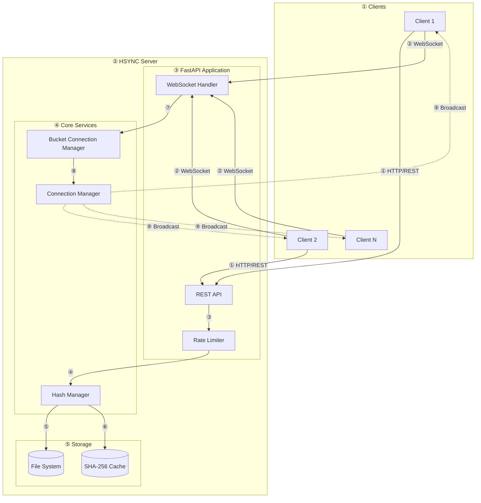
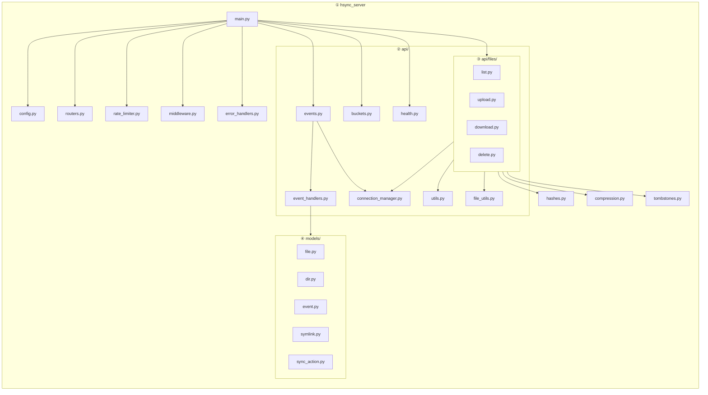
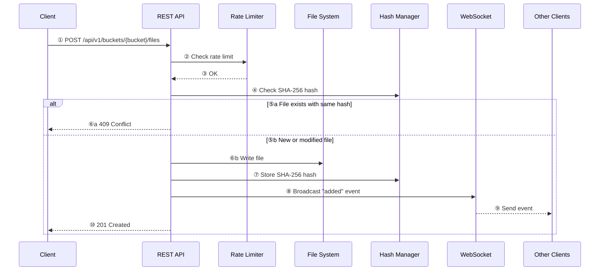
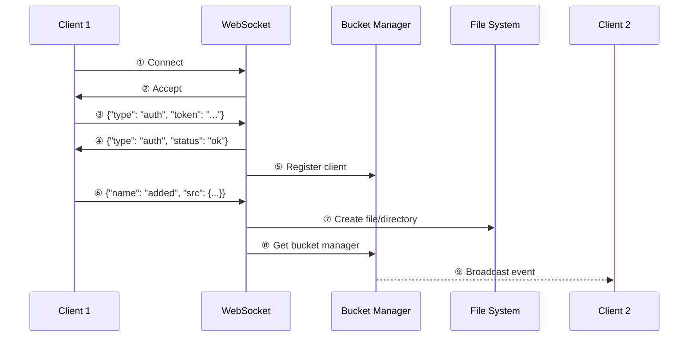

# HSYNC Server Architecture

This document describes the architecture of the HSYNC Server.

> The server builds on the shared models, constants, and utilities provided by
> `hsync-common`. See [HSYNC Common Architecture](../../hsync-common/docs/architecture.md)
> for the foundation it depends on, and the
> [Architecture Decision Records](../../hsync-common/docs/adr/README.md) for the
> *why* behind the ecosystem's stable decisions.

## System Overview

## Component Description

| Component | Description |
|-----------|-------------|
| **REST API** | Handles file upload, download, listing, and bucket management |
| **WebSocket Handler** | Manages real-time event synchronization between clients |
| **Rate Limiter** | Protects endpoints from abuse (slowapi) |
| **Connection Manager** | Manages WebSocket connections per bucket |
| **Bucket Connection Manager** | Isolates connections by bucket for scalability |
| **Hash Manager** | Caches SHA-256 hashes for duplicate detection |
| **File System** | Stores bucket data in `/buckets/{bucket_name}/` |

## Module Structure

> Tombstone REST endpoints (`GET`/`POST .../tombstones`) live in `api/files/list.py`
> and use the shared `tombstones.py` store; `health.py` also serves `/api/v1/time`.

## Data Flow

### File Upload Flow

### WebSocket Event Flow

