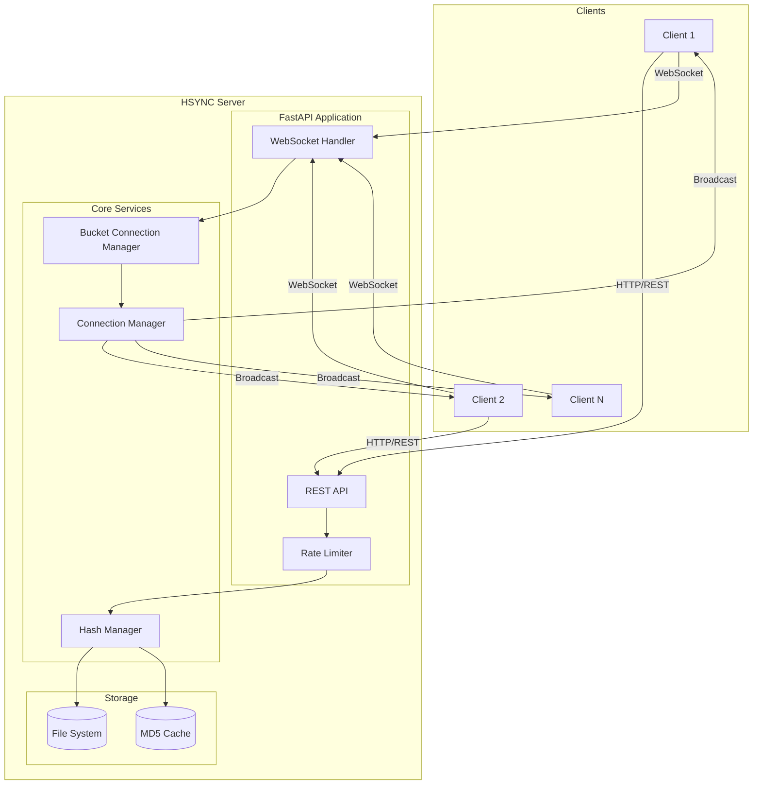
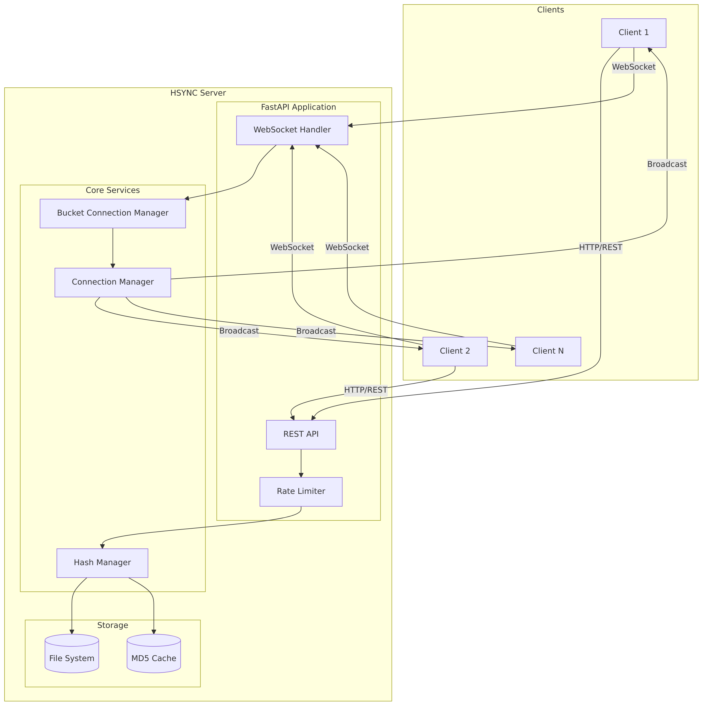
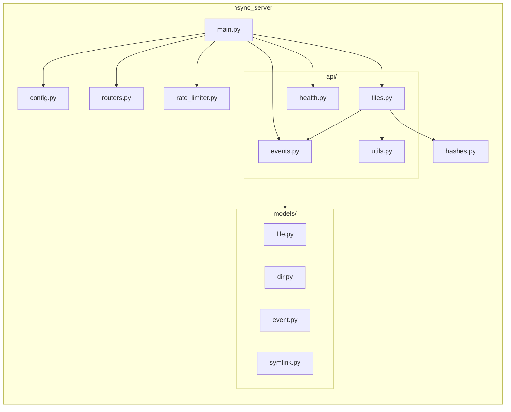
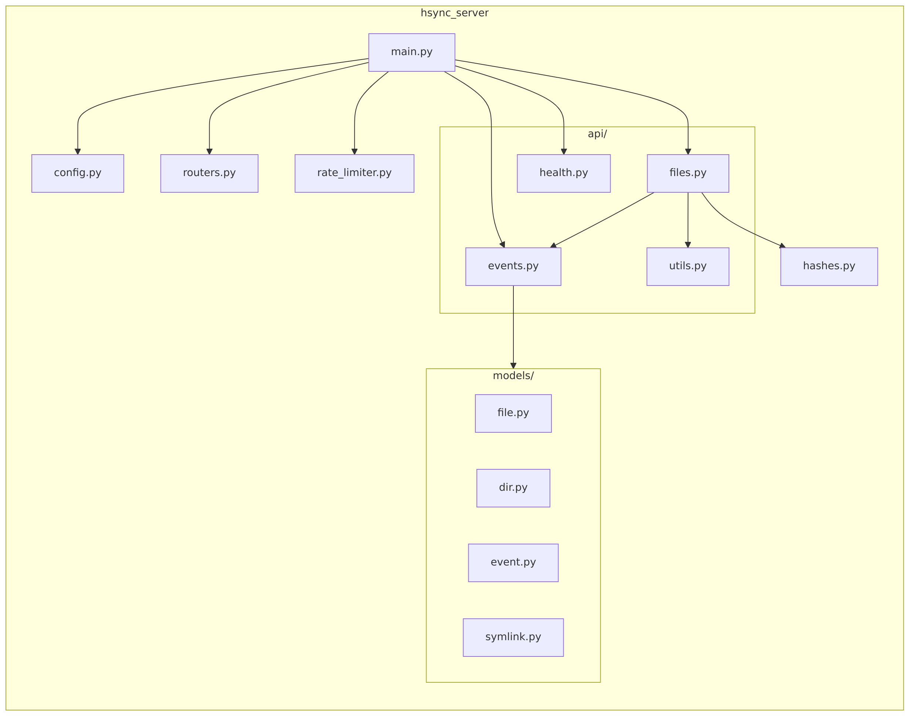
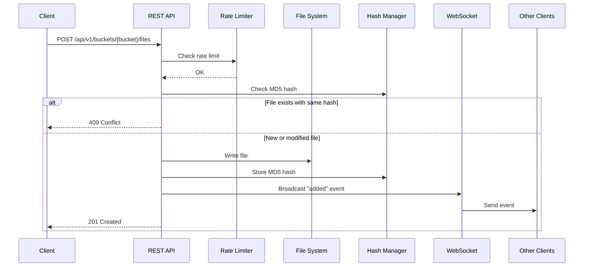
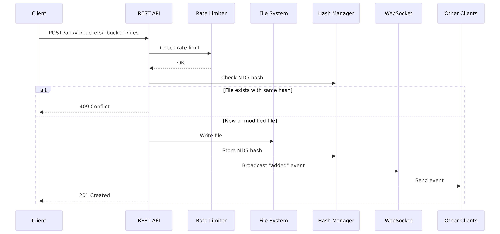
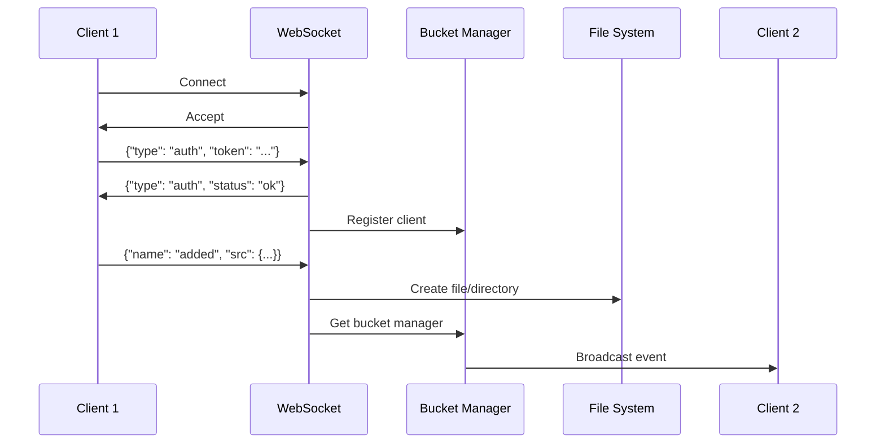
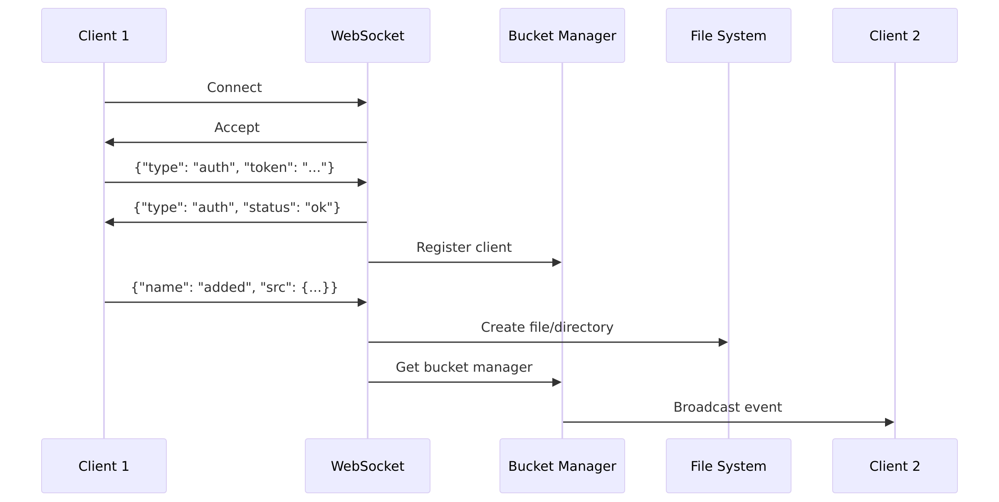

# HSYNC Server Architecture

This document describes the architecture of the HSYNC Server.

> **Note**: Diagrams are written in Mermaid. If they don't render, run `./generate-diagrams.sh` to generate PNG images in the `images/` directory.

## System Overview

## Component Description

| Component | Description |
|-----------|-------------|
| **REST API** | Handles file upload, download, listing, and bucket management |
| **WebSocket Handler** | Manages real-time event synchronization between clients |
| **Rate Limiter** | Protects endpoints from abuse (slowapi) |
| **Connection Manager** | Manages WebSocket connections per bucket |
| **Bucket Connection Manager** | Isolates connections by bucket for scalability |
| **Hash Manager** | Caches MD5 hashes for duplicate detection |
| **File System** | Stores bucket data in `/buckets/{bucket_name}/` |

## Module Structure

## Data Flow

### File Upload Flow

### WebSocket Event Flow

