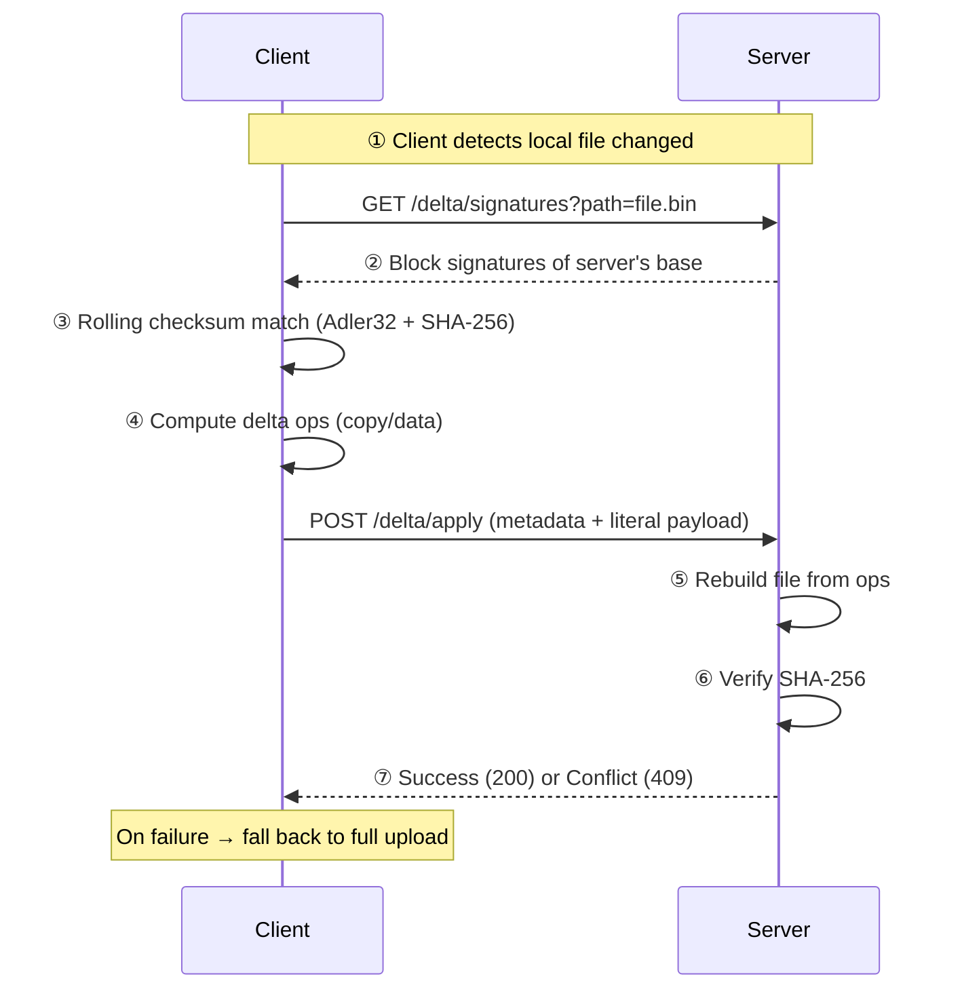
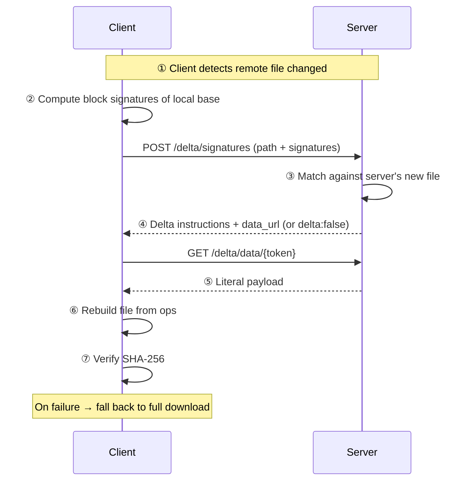

# Delta Transfer (rsync-style block sync)

Delta transfer is an **rsync-style block-level synchronization** protocol that
significantly reduces bandwidth usage when syncing large files with small changes.
Instead of transferring entire files, only the changed blocks are sent over the
network.

## Overview

When a file changes on one peer, HSYNC traditionally transfers the **entire file**
to the server and then to every other peer. For large files with minor changes
(e.g. a 100 MB video with a 1 MB edit), this wastes bandwidth and increases
latency.

Delta transfer solves this by:

1. **Splitting the file into blocks** and computing a weak (Adler32) + strong
   (SHA-256) checksum for each block.
2. **Matching blocks** between the old and new version using a rolling checksum.
3. **Transferring only the mismatched blocks** as literal data, while reusing
   matching blocks from the base file.

The result is that only the **changed bytes** are transferred, which can reduce
transfer size by 90%+ for files with small changes.

### When delta transfer triggers

Delta transfer is attempted automatically when **all** of these conditions are met:

1. **File size threshold**: file is ≥ 256 KB (server mode) or ≥ 1 MB (LAN mode)
2. **Base hash exists**: a previously synced version of the file is recorded in
   the installation `syncstate.db` (three-way merge state)
3. **Direction check**:
   - **Upload**: local file changed (`local_sha256 != base_hash`)
   - **Download**: local file is still the base (`local_sha256 == base_hash`) and
     remote file changed (`remote_sha256 != base_hash`)
4. **Capability**: both local and remote peers support delta transfer

If any condition is not met, the file is transferred in full — you never have to
choose manually.

## Core algorithm

The delta engine lives in `hsync_common.delta` and provides three core functions:

### `compute_signatures(file, block_size)`

Computes signatures for every block of the file:

- **Weak checksum**: Adler32 (32-bit, rolling) — used for fast candidate matching
- **Strong checksum**: SHA-256 (per block) — confirms the match and filters
  Adler32 collisions

Block size is adaptive based on file size:

| File size | Block size |
|-----------|------------|
| < 1 MB | 4 KB |
| 1–10 MB | 16 KB |
| 10–100 MB | 64 KB |
| > 100 MB | 256 KB |

### `find_matches(new_file, signatures, block_size)`

Scans the new file with a rolling Adler32 window, matching against the signatures
from the base file. Returns a list of **delta operations**:

- `copy(offset, length)` — reuse bytes from the base file
- `data(literal)` — literal payload for unmatched regions

Consecutive unmatched bytes are coalesced into a single `data` op. The partial
tail of the new file (last `< block_size` bytes) is always emitted as a `data` op.

### `apply_delta(base_file, ops, literal_data, output_file)`

Reconstructs the new file by executing the copy/data operations against the base
file combined with the literal data.

## REST endpoints

Delta transfer is exposed via four endpoints under
`/api/v1/buckets/{bucket}/files/delta/`:

| Method | Endpoint | Purpose |
|--------|----------|---------|
| `GET` | `/delta/signatures?path={path}` | Fetch block signatures of the server's base file (used for **upload delta**) |
| `POST` | `/delta/signatures` | Send client block signatures; server returns delta instructions + data URL (used for **download delta**) |
| `POST` | `/delta/apply` | Upload literal data + metadata; server rebuilds the file (used for **upload delta**) |
| `GET` | `/delta/data/{token}` | Download the literal payload parked by the server (used for **download delta**) |

The `data_url` returned by `POST /delta/signatures` is a **single-use,
time-limited token** (TTL 300 s) that points to a temporary file on the server.
This avoids holding large literal payloads in memory and allows the server to
stream the data efficiently.

### Rate limits

| Endpoint | Rate limit |
|----------|------------|
| `GET /delta/signatures` | 100/min |
| `POST /delta/signatures` | 100/min |
| `POST /delta/apply` | 100/min |
| `GET /delta/data/{token}` | 100/min |

## Upload delta flow

When a client detects that a local file has changed and delta transfer is
applicable, it performs an **upload delta**:



## Download delta flow

When a client detects that a remote file has changed and delta transfer is
applicable, it performs a **download delta**:



## Configuration

Delta transfer is **enabled by default**. The following environment variables
control its behavior:

| Variable | Default | Description |
|----------|---------|-------------|
| `HSYNC_DELTA_ENABLED` | `true` | Enable/disable delta transfer endpoints on the server |
| `HSYNC_DELTA_TOKEN_TTL` | `300` | Seconds a literal-payload download token stays valid |
| `HSYNC_RATE_LIMIT_DELTA` | `100/minute` | Rate limit for delta transfer endpoints |

`HSYNC_DELTA_MIN_FILE_SIZE` and `HSYNC_DELTA_MAX_CHANGE_RATIO` may appear in
the settings model but the **server does not read them**. Worthwhileness
(minimum size, max change ratio) is decided by the client using
`hsync-common` constants. Changing those two variables on the server has no
effect.

Disable delta transfer with:

```bash
export HSYNC_DELTA_ENABLED=false
```

## Capability negotiation

Delta transfer is advertised as a **capability token** (`delta`) in the REST
handshake and as a **TXT record key** (`delta=true`) in LAN mDNS discovery.
Peers only attempt delta transfer when **both** sides support it.

If a peer does not advertise the `delta` capability, all transfers fall back to
full file transfer automatically.

## Fallback behavior

Delta transfer failures are **transparent**: if any step fails (network error,
hash mismatch, base file changed mid-transfer, peer doesn't support delta), the
client automatically falls back to a full file transfer. The retry policy is
unchanged — delta failures do not consume retry attempts.

Common failure scenarios:

| Scenario | Behavior |
|----------|----------|
| Base file changed on server during delta | `409 Conflict` → client retries with fresh signatures |
| Peer doesn't support delta | Capability negotiation → full transfer |
| Network error during delta | Retry with full transfer |
| Hash mismatch after rebuild | Retry with full transfer |
| Worthwhileness gate (> 50% change) | Automatic fallback to full transfer |

## Concurrency

The server's `POST /delta/apply` endpoint uses a **per-file lock** to serialize
concurrent delta applies on the same file. This prevents race conditions where
multiple clients would write to the same `.delta.part` file simultaneously.

If two clients attempt concurrent applies on the same file, one will succeed and
the other will receive a `409 Conflict` response (base file changed), which is
the expected behavior for the delta protocol.

## Metrics

The server exposes Prometheus metrics for delta transfer:

| Metric | Type | Description |
|--------|------|-------------|
| `hsync_delta_transfer_total` | Counter | Total delta transfer attempts, tagged by `status` (`success`, `failure`, `rejected`, `conflict`) and `direction` (`upload`, `download`) |
| `hsync_delta_bytes_saved` | Counter | Estimated bytes saved by delta transfer (original size - transferred size) |
| `hsync_delta_transfer_duration_seconds` | Histogram | Duration of delta transfer operations by phase (`signatures`, `match`, `apply`, `data`, `total`) |
| `hsync_delta_block_change_ratio` | Histogram | Ratio of changed blocks in delta transfer (0.0 = no change, 1.0 = all changed) |
| `hsync_delta_active_tokens` | Gauge | Number of currently active delta download tokens |
| `hsync_delta_temp_storage_bytes` | Gauge | Total bytes used by delta transfer temporary files |

Example PromQL queries:

```promql
# Delta transfer success rate
rate(hsync_delta_transfer_total{status="success"}[5m])
/
rate(hsync_delta_transfer_total[5m])

# Bytes saved per minute
rate(hsync_delta_bytes_saved[5m])

# Delta conflicts per minute
rate(hsync_delta_transfer_total{status="conflict"}[5m])
```

## See also

- [API Reference](api.md#delta-transfer) — REST endpoint details
- [Operations Guide](operations.md) — Prometheus metrics and monitoring
- [Sync Flow](sync-flow.md) — server-side synchronization flow
- [ADR 0016: Delta Transfer](https://github.com/albertosdk/hsync-common/blob/main/docs/internal/adr/0016-delta-transfer.md)
  — architecture decision record with rationale and alternatives
- [Client Sync Flow — Server Mode](https://github.com/albertosdk/hsync-client/blob/main/docs/sync-flow-server.md)
  — client-side delta transfer documentation
- [Client Configuration → Delta Transfer](https://github.com/albertosdk/hsync-client/blob/main/docs/configuration.md#delta-transfer-rsync-style-block-sync)
  — client-side delta transfer configuration
