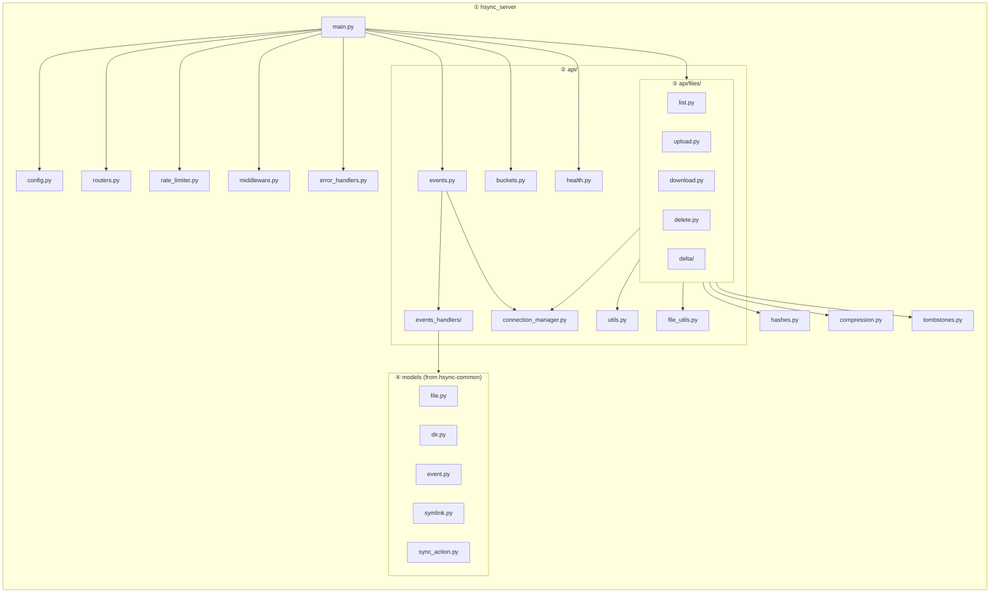

# HSYNC Server — Developer Guide

This page covers internal implementation details useful for contributors and
developers working on the HSYNC Server codebase.

> For the high-level system design, see [Architecture](architecture.md).
> For the sync protocol and event flow, see [Sync Flow](../sync-flow.md).

## Table of Contents

- [Metadata Overhead](#metadata-overhead)
- [Module Structure](#module-structure)
- [Component Details](#component-details)
- [Two-Router Architecture](#two-router-architecture)
- [WebSocket Lifecycle](#websocket-lifecycle)
- [Middleware Chain](#middleware-chain)

---

## Metadata Overhead

Synced file bytes are plain files on disk. Causal metadata is SQLite
(`<state_dir>/syncstate.db`: versions, tombstones, accounts, membership).

- **SHA-256 cache**: in-memory `FILE_HASHES` dict in `hashes.py` (not
  persisted, **not** LRU). Rebuilt at startup; stale on mtime/size mismatch;
  unbounded for the process lifetime.
- **Tombstones / versions**: SQLite tables via `tombstones.py` / `versions.py`,
  not per-bucket JSON files.

For production capacity planning, see
[System Requirements](../deployment.md#system-requirements).

## Module Structure



> Tombstone REST endpoints (`GET`/`POST .../tombstones`) live in `api/files/list.py`
> and use the shared `tombstones.py` store; `health.py` also serves `/api/v1/time`.

## Component Details

| Module | File | Purpose |
|--------|------|---------|
| Application entry | `main.py` | FastAPI app creation, lifespan, middleware wiring |
| Configuration | `config.py` | Pydantic-settings model for all `HSYNC_*` env vars |
| Routes | `routers.py` | Top-level router aggregation |
| Hashing | `hashes.py` | SHA-256 computation and in-memory (unbounded) cache |
| Rate limiting | `rate_limiter.py` | Per-endpoint rate limits via slowapi |
| Middleware | `middleware.py` | Request logging, CORS, trusted proxy handling |
| Error handlers | `error_handlers.py` | Global exception handlers |
| Compression | `compression.py` | Zstandard (zstd) transfer encoding support |
| Tombstones | `tombstones.py` | Deletion marker store per bucket |
| WebSocket | `api/events.py` | WebSocket endpoint, auth, and message dispatch |
| Event handlers | `api/events_handlers/` | Business logic for each WebSocket event type |
| Bucket management | `api/buckets.py` | Bucket CRUD endpoints |
| Health | `api/health.py` | `/health`, `/metrics`, `/api/v1/time` |
| Connection mgr | `api/connection_manager.py` | Per-bucket WebSocket connection tracking |
| File listing | `api/files/list.py` | File listing + tombstone endpoints |
| File upload | `api/files/upload.py` | Upload with resumable support |
| File download | `api/files/download.py` | File download with range support |
| File deletion | `api/files/delete.py` | File deletion + tombstone creation |
| Delta transfer | `api/files/delta/` | Rsync-style block-level delta transfer endpoints |
| Utilities | `api/utils.py` | Request helpers |
| File utilities | `api/file_utils.py` | Path safety, disk space checks |
| File locks | `file_lock_manager.py` | Per-file asyncio lock manager for concurrent operations |
| Metrics | `metrics.py` | Prometheus metrics for delta transfer operations |
| Logging | `logger.py` | Loguru configuration, intercept handler, rotation |
| Exceptions | `exceptions.py` | Custom exception hierarchy (`HSyncError` base) |
| Constants | `constants.py` | Server-side constants |
| SSL utilities | `ssl_utils.py` | Certificate generation, SSL context creation |
| Module entry | `__main__.py` | `python -m hsync_server` entry point |

## Two-Router Architecture

The server uses two FastAPI routers to separate authenticated and public
endpoints:

| Router | Prefix | Auth | Endpoints |
|--------|--------|------|-----------|
| `auth_router` | `/api/v1` | Requires `Authorization: Bearer <account_token>` | Buckets, files, tombstones, delta transfer, membership |
| `admin_router` | `/api/v1/admin` | Requires `admin` role | Account CRUD, bucket inventory |
| `public_router` | (root) | None | `/health`, `/metrics`, `/api/v1/time`, WebSocket events |

The `auth_router` dependency chain enforces account-token validation on every
request. The `admin_router` adds the `admin`-role check on top. The
`public_router` carries no auth dependency, making health checks and metrics
accessible to load balancers and monitoring tools without credentials.

```python
# Simplified wiring from main.py
app = FastAPI()
app.include_router(public_router)  # no auth
app.include_router(auth_router)  # account token required
app.include_router(admin_router)  # admin role required
```

## WebSocket Lifecycle

Each WebSocket connection goes through a defined lifecycle:

```
① Client connects    →  ws://host:9753/api/v1/buckets/{bucket}/events/{cid}
② Slot acquisition   →  connection_manager.acquire_slot(client_ip)
                           Rejects if max connections per IP or total exceeded
③ Auth timeout       →  Client must send {"type": "auth", "token": "..."}
                           within HSYNC_WS_AUTH_TIMEOUT seconds (default 10)
④ Authentication     →  account token verified (scrypt) against the auth store
⑤ Registration       →  Client registered to bucket's connection pool
⑥ Heartbeat loop     →  Server sends ping every HSYNC_WS_HEARTBEAT_INTERVAL (30s)
                           Client must respond with pong within HSYNC_WS_HEARTBEAT_TIMEOUT (10s)
⑦ Event broadcast    →  Incoming events fanned out to all other clients in bucket
⑧ Disconnect         →  Slot released, client removed from bucket pool
```

### Slot acquisition for DoS protection

Before accepting a WebSocket connection, the server checks:

- **Per-IP limit** (`HSYNC_WS_MAX_CONNECTIONS_PER_IP`, default 10)
- **Global limit** (`HSYNC_WS_MAX_CONNECTIONS`, default 1000)

If either limit is exceeded, the connection is rejected with a close code
before the handshake completes — no resources are allocated. Slots are
automatically released on disconnect or heartbeat timeout.

### Capabilities negotiation

During the WebSocket handshake, the server and client exchange capabilities
via the auth message JSON payload. The client sends its capabilities in the
`capabilities` field of the auth frame; the server replies with the
capabilities it supports for the session (e.g., `compression` when
`HSYNC_COMPRESSION_ENABLED=true`). A `protocol_version` mismatch is a hard
failure (close code `4002`).

The client can use the advertised capabilities to adapt its behavior (e.g.,
enable compression for transfers).

## Middleware Chain

The server applies middleware in this order:

| Order | Middleware | Purpose |
|-------|-----------|---------|
| 1 | Version | Enforce wire-protocol version (hard-fail 426 on mismatch); stamp `X-Server-Version`/`X-Protocol-Version` |
| 2 | Request ID | Assign a unique `X-Request-ID` to every request for log correlation |
| 3 | CORS | Cross-Origin Resource Sharing headers (when `HSYNC_CORS_ENABLED=true`) |
| 4 | GZip (`TransferAwareGZipMiddleware`) | Compress API responses larger than 1000 bytes; the transfer payload endpoints (`…/files/download`, `…/files/delta/data/{token}`) are excluded, because their `Content-Encoding` is the sync protocol's own (identity or zstd) and a client rejects anything else |
| 5 | Rate limiter | Apply per-endpoint rate limits (slowapi) |

Middleware is registered in `main.py` during application startup. The order
matters: `VersionMiddleware` runs first so protocol-version mismatches are
rejected before any other processing, and `RequestIdMiddleware` assigns the
correlation ID before downstream middleware and handlers use it. Trusted-proxy
handling for `X-Forwarded-For` is performed inside the rate limiter's client-IP
resolution (`rate_limiter.py`), not as a separate middleware.

## See also

- [Architecture](architecture.md) — high-level system overview and data flows.
- [Sync Flow](../sync-flow.md) — server-side sync flow.
- [API Reference](../api.md) — complete REST + WebSocket contract.
- [Contributing](../../CONTRIBUTING.md) — development setup and guidelines.
- [HSYNC Common docs](https://github.com/albertsdk/hsync-common/blob/main/docs/README.md) — shared models and protocol.
