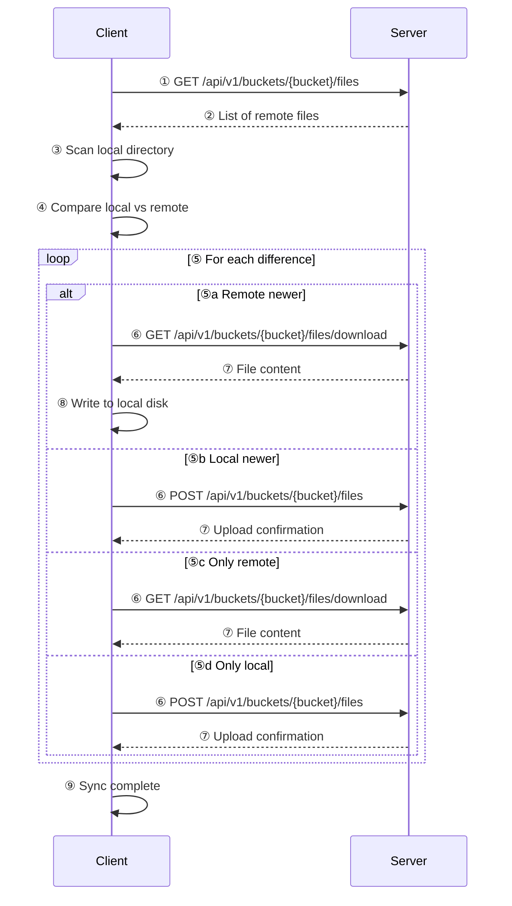
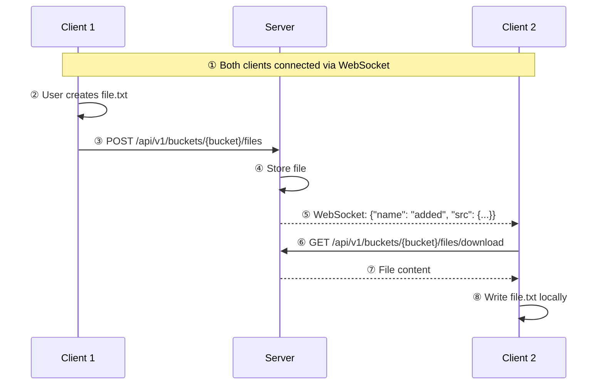
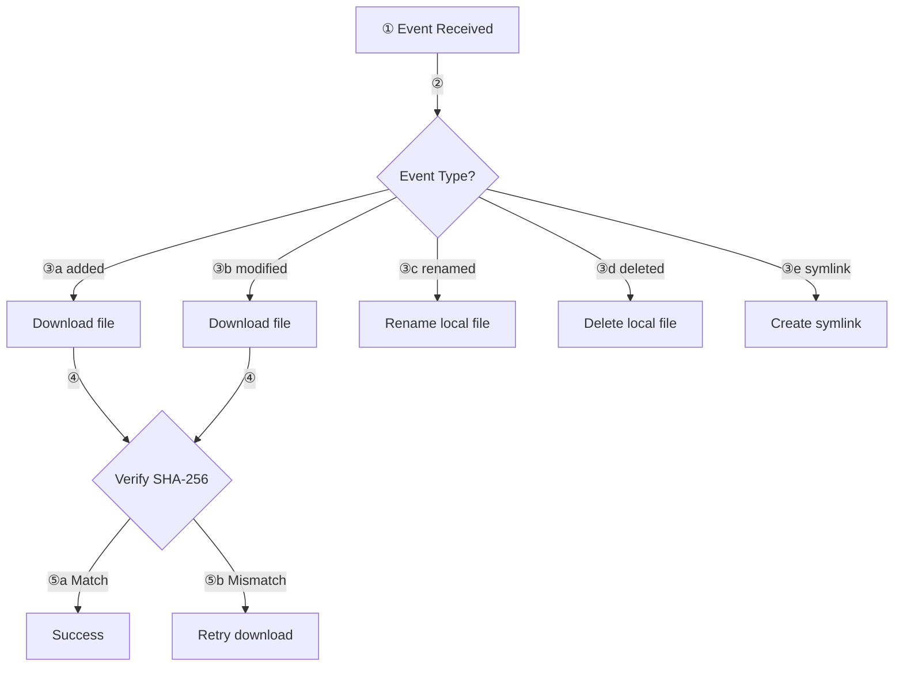
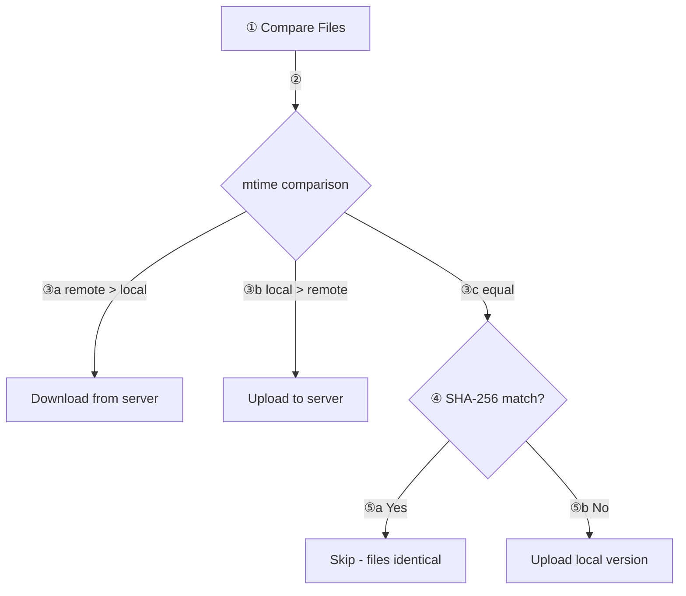
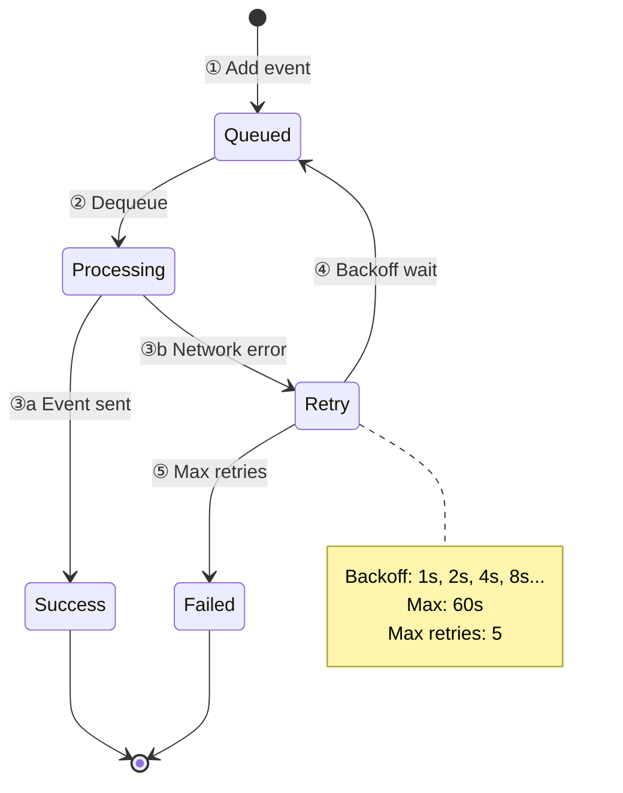
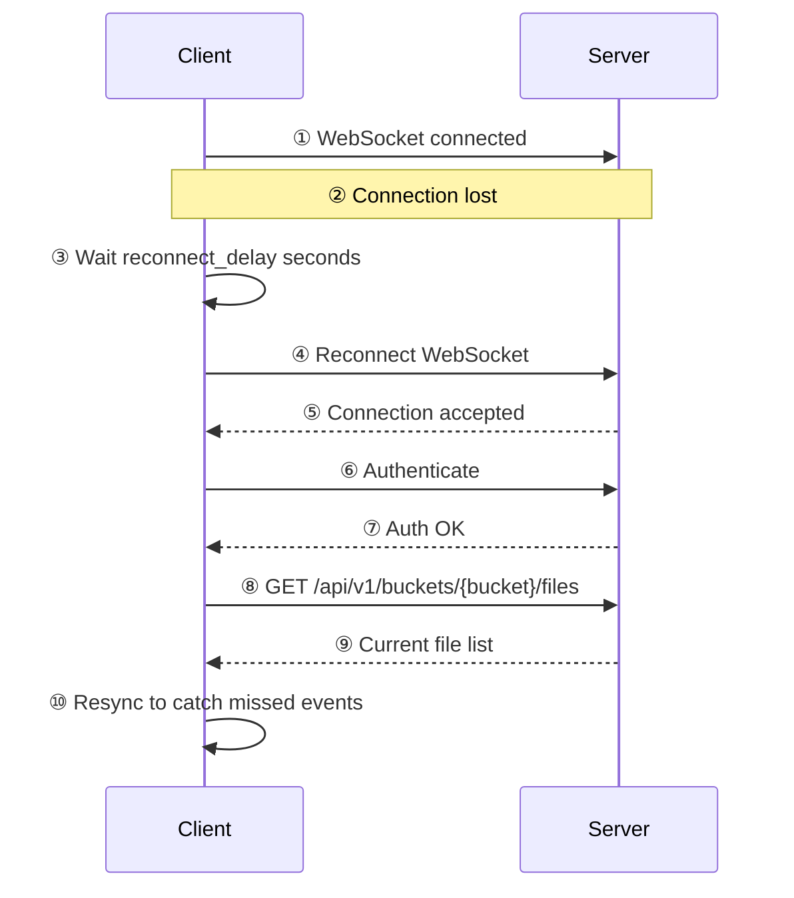

# HSYNC Synchronization Flow

This document describes how file synchronization works between clients through the HSYNC server.

## Overview

HSYNC uses a combination of REST API for file transfers and WebSocket for real-time event propagation.

## Initial Synchronization

When a client starts, it performs a full sync to ensure consistency:

## Real-Time Synchronization (Watch Mode)

In watch mode, clients maintain a WebSocket connection for instant updates:

## Event Types and Actions

## Conflict Resolution

HSYNC uses "last write wins" based on modification time:

## Event Queue and Retry

The client uses an event queue with exponential backoff for reliability:

## Connection Recovery

When the WebSocket connection is lost:

