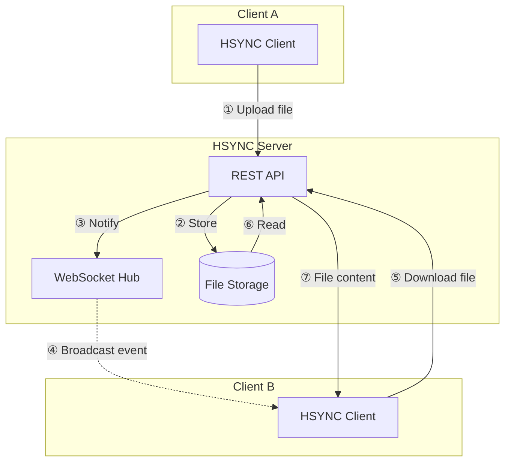
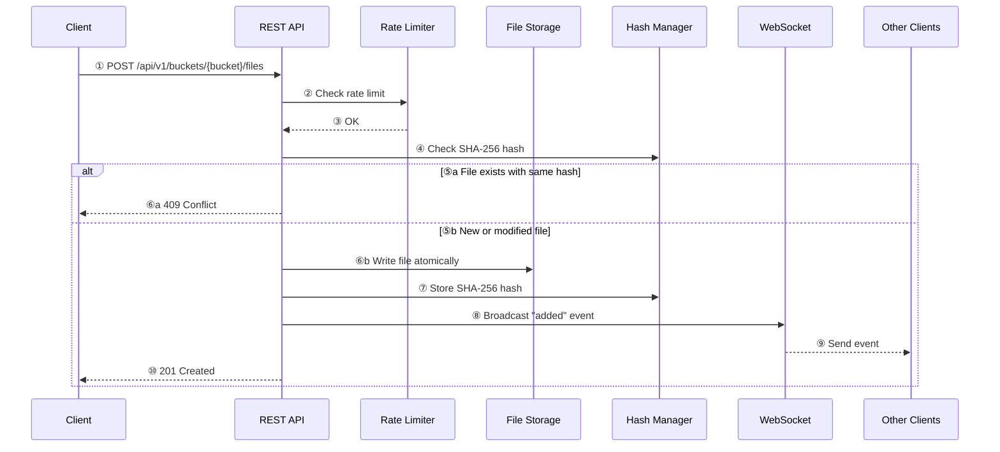
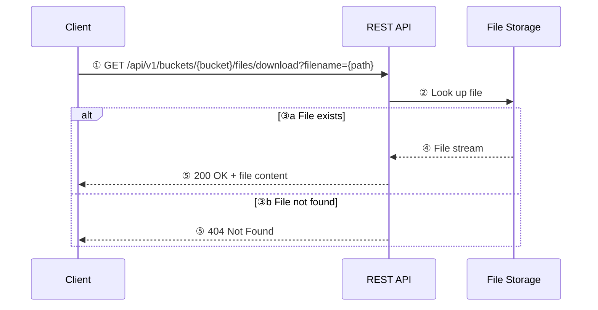
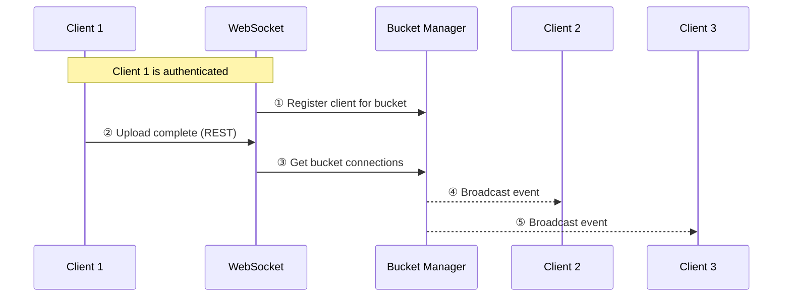
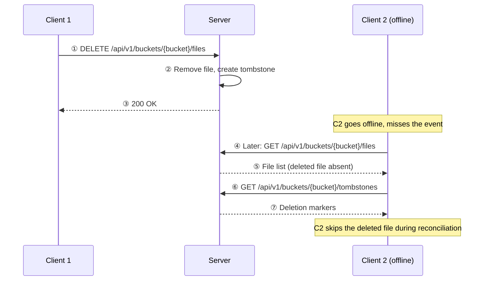
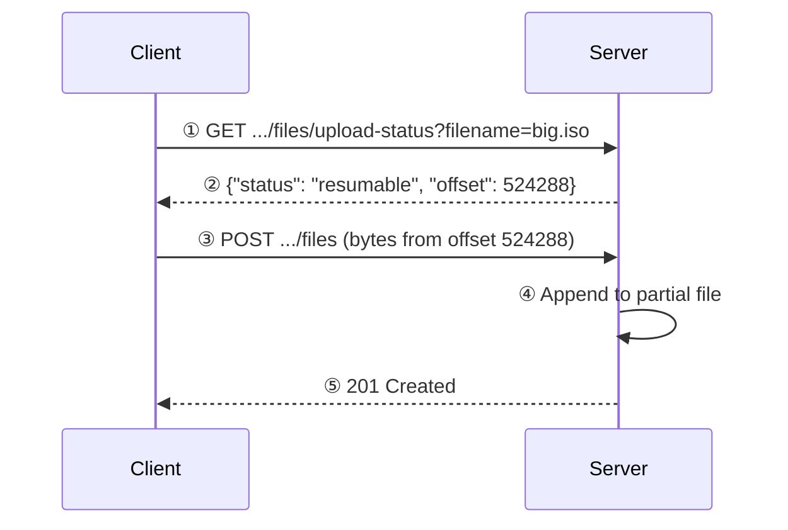

# Server Synchronization Flow

This document describes how the HSYNC server handles file synchronization from
its own perspective. The server is a **passive relay**: it stores files,
broadcasts events, and lets clients decide what to do.

> For the client-side flow (initial sync, conflict resolution, event queue,
> retry logic, connection recovery) see the
> [client Sync Flow](https://github.com/albertobasso/hsync-client/blob/main/docs/sync-flow.md).

## Overview

## Server responsibilities

The server has three core responsibilities:

1. **Store files** — accept uploads, serve downloads, manage buckets
2. **Broadcast events** — relay change notifications to connected clients
3. **Track deletions** — maintain tombstones so offline peers don't resurrect deleted files

The server does **not**:
- Decide which files to sync (the client decides)
- Decide conflicts by role (uploads are arbitrated **causally** against the
  stored version with a deterministic SHA-256 tie-break on true divergence,
  ADR-0022/ADR-0003 — never by wall clock)
- Queue or retry events (the client retries on disconnect)
- Watch the filesystem (the client watches its local directory)

## File upload flow

## File download flow

## WebSocket event broadcast

When a client uploads, modifies, renames, or deletes a file, the server
broadcasts the event to all **other** clients connected to the same bucket:

The server does **not** echo the event back to the originating client (the
originating client already knows about its own change).

## Tombstone flow

Deletion markers (tombstones) prevent offline clients from resurrecting files
they missed being deleted:

## Resumable upload

The server tracks partial uploads so clients can resume interrupted transfers
without re-sending already transferred bytes:

### How it works

1. **Before upload**, the client checks the upload status endpoint. The server
   returns either `{"status": "resumable", "offset": N}` (bytes already
   received) or `{"offset": 0}` (no partial upload exists).

2. **During upload**, the server writes incoming bytes to a partial file
   (`.hsyncpart` suffix) alongside the target path. If the connection drops,
   the partial file preserves the received bytes.

3. **On completion**, the partial file is atomically renamed to the target
   filename. The SHA-256 hash is computed and stored in the cache.

4. **Cleanup**: Partial files left behind after a server restart are removed
   during the next bucket scan. The client also cleans up its own partial
   downloads at the start of each sync cycle.

### Resumable vs. restart

- An upload is **resumable** if the partial file still exists on the server
  and the client's `Content-Range` header matches the stored offset.
- An upload **restarts** if the file was deleted on the server, the partial
  file was cleaned up, or the client's local file hash changed since the
  partial upload began.

## Health and monitoring

The server exposes unauthenticated endpoints for operational monitoring:

- `GET /health` — returns empty `200 OK` (liveness probe)
- `GET /metrics` — Prometheus metrics
- `GET /api/v1/time` — server timestamp for client clock-sync

## See also

- [API Reference](api.md) — complete REST + WebSocket contract.
- [Architecture](internal/architecture.md) — server components and module structure.
- [FAQ](faq.md) — frequently asked questions.
